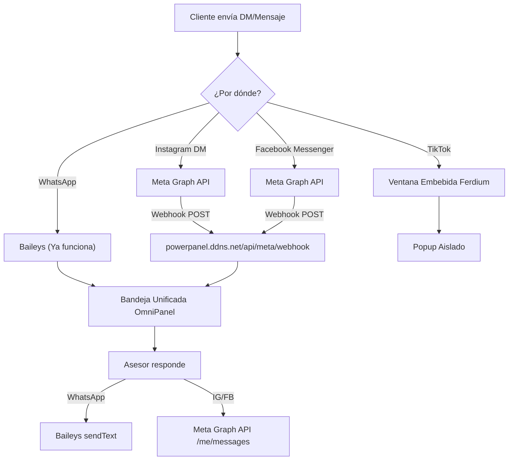

# 📘 Documentación Maestra y Guía de Rollback — OmniPanel Consorcio (Arquitectura Modular)

> [!IMPORTANT]
> **Propósito de este documento:**
> Este manual técnico documenta de forma explícita toda la arquitectura modular del **OmniPanel Consorcio (Agropower & Tractopower)**, cómo construir el panel desde cero, qué hace cada sección visual y lógica, qué elementos contiene, qué módulo la gobierna, cuáles son sus endpoints exactos y cómo realizar un **rollback inmediato** ante cualquier eventualidad.
> **Regla de mantenimiento:** Cada vez que se cree, modifique o actualice una función u opción del panel, este documento se actualizará en su sección correspondiente y en la **Bitácora de Versiones y Rollback (Sección 6)**.

---

## 1. Arquitectura General y Estructura Modular del Proyecto

El sistema dejó de ser monolítico y está dividido en **capas modulares independientes** tanto en el **Backend (`src/`)** como en el **Frontend (`public/js/` y `public/css/`)**, garantizando escalabilidad, mantenibilidad y aislamiento de fallos.


### 1.1. Árbol de Archivos del Proyecto (`omnipanel-consorcio/`)

```text
omnipanel-consorcio/
├── server.js                          # Punto de entrada del servidor HTTP + Socket.io (~76 líneas)
├── whatsappService.js                 # Motor de conexión WhatsApp QR (Baileys integrado / Evolution API)
├── package.json                       # Dependencias y scripts de ejecución
├── botConfig.json                     # Configuración de bienvenida, opciones personalizadas, horario, empresas y plantillas
├── channelVault.json                  # Bóveda criptográfica de canales (AES-256-GCM + Hash HMAC-SHA256, cero texto plano)
├── conversations.json                 # Base de datos de conversaciones reales activas
├── users.json                         # Base de datos de usuarios (Admin principal + asesores administrables)
├── analytics.json                     # Registro histórico de eventos de atención, sesiones y ventas cerradas
├── docs/
│   └── DOCUMENTACION_MAESTRA_OMNIPANEL.md  # Esta documentación técnica maestra y guía de rollback
├── src/                               # CAPA BACKEND MODULAR
│   ├── config/
│   │   └── constants.js               # Constantes globales, rutas de archivos, canales y mensaje de bienvenida base
│   ├── middleware/
│   │   ├── securityMiddleware.js      # Cabeceras HTTP (CSP/HSTS), sanitización Anti-XSS/NoSQL/HPP y Rate Limiters
│   │   └── authMiddleware.js          # Middlewares requireAuth (sesión activa) y requireAdmin (exclusivo Admin)
│   ├── services/
│   │   ├── storageService.js          # Lectura/escritura atómica de JSONs y utilidades de empresa/canal
│   │   ├── channelVaultService.js     # Bóveda Criptográfica (AES-256-GCM + SHA-256) para OAuth 2.0, Baileys/Evolution y Puente IA Gemini
│   │   ├── scheduleService.js         # Cálculo de horario laboral (08:00 a 17:00) y selección de auto-respuesta
│   │   ├── sessionService.js          # Sesiones en memoria, hash timing-safe y conteo de tiempo de conexión de asesores
│   │   ├── whatsappHandler.js         # Recepción de mensajes de WhatsApp en tiempo real y disparo del bot fuera de horario
│   │   └── analyticsService.js        # (v3.2) Almacenamiento particionado por día (data/analytics/YYYY-MM-DD.json), retención 90 días, consultas por rango
│   └── routes/
│       ├── authRoutes.js              # Endpoints de Login, Logout, Verificación de sesión y Heartbeat
│       ├── whatsappRoutes.js          # Endpoints de estado QR, reinicio y desvinculación de WhatsApp
│       ├── conversationRoutes.js      # Endpoints de chats, envío de mensajes, simulador, pausa de bot y cierre de venta
│       ├── configRoutes.js            # Endpoints de plantillas, bienvenida, horario laboral y subida/borrado de PDF
│       ├── channelAuthRoutes.js       # Endpoints de login OAuth 2.0 (IG/TK/FB) y conexión Baileys/Evolution (WA) con Zero-Leak HTTP
│       ├── userRoutes.js              # Endpoints CRUD de usuarios (Crear, Listar, Modificar, Eliminar)
│       └── analyticsRoutes.js         # (v3.2) 7 endpoints de estadísticas con rango de fechas, semanas ISO, comparación de asesores
└── public/                            # CAPA FRONTEND MODULAR
    ├── index.html                     # Shell raíz ultraligero (47 líneas) con puntos de montaje (#mount-*)
    ├── css/
    │   └── styles.css                 # Estilos personalizados y scrollbars
    ├── sections/                      # BLOQUES HTML MODULARES POR SECCIÓN
    │   ├── login.html                 # Bloque 1: Pantalla de Login Seguro (#loginScreenOverlay)
    │   ├── header.html                # Bloque 2: Barra Superior de Navegación y Estado de Sesión (#mainHeader)
    │   ├── inbox.html                 # Bloque 3: Bandeja Omnicanal de 8 Canales, Chat y Simulador (#viewInbox)
    │   ├── stats.html                 # Bloque 4: Dashboard de Estadísticas y Modal de Informe Semanal (#viewStats)
    │   ├── settings.html              # Bloque 5: Contenedor de Ajustes (#viewSettings) con 5 sub-puntos de montaje
    │   ├── settings-users.html        # Sub-bloque 5.1: Gestión de Usuarios Administrables y Admin
    │   ├── settings-companies.html    # Sub-bloque 5.2: Empresas y Canales Logueados (OAuth 2.0 + Baileys/Evolution + Modal)
    │   ├── settings-whatsapp.html     # Sub-bloque 5.3: Vinculación WhatsApp QR y Modo de Conexión
    │   ├── settings-schedule.html     # Sub-bloque 5.4: Horario Laboral (8am-5pm) y Respuesta Automática
    │   └── settings-templates.html    # Sub-bloque 5.5: Mensaje de Bienvenida, Nuevas Opciones, Plantillas y PDF
    ├── media/                         # Carpeta donde se almacena el Catálogo PDF oficial subido desde la PC
    └── js/                            # LÓGICA JAVASCRIPT MODULAR POR RESPONSABILIDAD
        ├── state.js                   # Estado global reactivo, metadatos de los 8 canales y constantes UI
        ├── api.js                     # Interceptor seguro de window.fetch (adjunta Bearer Token y CSRF Token)
        ├── loader.js                  # Cargador asíncrono que inyecta public/sections/*.html en public/index.html
        ├── auth.js                    # Lógica de Login, bloqueo por Rate-Limit, RBAC por rol y cambio de vistas
        ├── inbox.js                   # Lógica de Bandeja de Entrada, renderizado de chats, envío rápido y Cerrar Venta
        ├── settings.js                # Lógica de Ajustes, Mensaje de Bienvenida, Constructor de Opciones, Horario, PDF y QR
        ├── channels.js                # Lógica de Canales Logueados (OAuth 2.0 para IG/TK/FB y Baileys/Evolution para WA)
        ├── users.js                   # Lógica de creación, edición y eliminación de usuarios administrables
        ├── analytics.js               # Lógica del Dashboard de Estadísticas y Modal de Informe Semanal Ejecutivo
        └── main.js                    # Orquestador de arranque (await loadModularSections -> Socket.io -> initAuthSession)
```

---

## 2. Guía Explícita para Construir e Iniciar el Panel desde Cero

### 2.1. Requisitos del Sistema
- **Node.js:** versión `18.x` o superior (probado en `v24.16.0`).
- **Gestor de paquetes:** `npm`.
- **Sistema Operativo:** Windows, Linux o macOS.

### 2.2. Dependencias (`package.json`)
Para construir el proyecto desde cero en una carpeta limpia:
```bash
npm init -y
npm install express socket.io cors dotenv axios qrcode @whiskeysockets/baileys pino
```

El archivo `package.json` debe contener:
```json
{
  "name": "omnipanel-consorcio",
  "version": "2.0.0",
  "description": "Panel Omnicanal Modular para Consorcio Agropower & Tractopower",
  "main": "server.js",
  "scripts": {
    "start": "node server.js"
  },
  "dependencies": {
    "@whiskeysockets/baileys": "^6.7.16",
    "axios": "^1.7.9",
    "cors": "^2.8.5",
    "dotenv": "^16.4.7",
    "express": "^4.21.2",
    "pino": "^9.6.0",
    "qrcode": "^1.5.4",
    "socket.io": "^4.8.1"
  }
}
```

### 2.3. Comandos de Verificación y Puesta en Marcha
1. **Verificar sintaxis de todos los módulos Backend y Frontend:**
   ```powershell
   node -c server.js
   node -c src/config/constants.js
   node -c src/middleware/securityMiddleware.js
   node -c src/middleware/authMiddleware.js
   node -c src/services/storageService.js
   node -c src/services/scheduleService.js
   node -c src/services/sessionService.js
   node -c src/services/whatsappHandler.js
   node -c src/routes/authRoutes.js
   node -c src/routes/whatsappRoutes.js
   node -c src/routes/conversationRoutes.js
   node -c src/routes/configRoutes.js
   node -c src/routes/userRoutes.js
   node -c src/routes/analyticsRoutes.js
   ```
2. **Iniciar el servidor en vivo:**
   ```powershell
   node server.js
   ```
3. **Acceder desde el navegador:**
   Abrir `http://localhost:3000` (o `http://localhost:3000/login`).

---

## 3. Documentación Explícita por Sección del Panel

A continuación se detalla cada sección del sistema: **qué hace**, **qué elementos contiene**, **qué archivos la controlan**, **cuál es su endpoint** y **cómo funciona internamente**.

---

### SECCIÓN 1: Página de Login Seguro y Control de Acceso (`#loginScreenOverlay`)

- **¿Qué hace?**
  Bloquea el acceso a todo el panel hasta que el usuario se autentique con credenciales válidas. Inicia el registro de estadísticas de sesión **únicamente si quien ingresa es un Asesor (`operator`)**, manteniendo al usuario **Administrador (`admin`) exento de estadísticas**.
- **¿Qué elementos lleva en la interfaz?**
  - Campo ` Nombre de Usuario` (`#loginUsername`) con validación de caracteres seguros (`^[a-zA-Z0-9._-]+$`).
  - Campo `Contraseña` (`#loginPassword`) con botón mostrar/ocultar (`#loginPwdEyeIcon`).
  - Caja de alertas de error y cuenta regresiva de bloqueo por fuerza bruta (`#loginErrorBox`).
  - Botón `Iniciar Sesión en el Panel` (`#btnLoginSubmit`).
- **Módulos que la gobiernan:**
  - **Frontend:** `public/js/auth.js` (`submitLoginForm`, `startLockoutCountdown`, `initAuthSession`, `onAuthenticatedSuccess`) y `public/js/api.js` (interceptor Fetch).
  - **Backend:** `src/routes/authRoutes.js`, `src/middleware/securityMiddleware.js`, `src/services/sessionService.js`.
- **Endpoints asociados:**
  - `POST /api/auth/login` — Valida credenciales en tiempo constante (`crypto.timingSafeEqual`), aplica Rate Limit (máx. 5 intentos fallidos / 15 min de bloqueo por IP), emite Cookie `HttpOnly; SameSite=Strict` (`omnipanel_sid`) + `token` Bearer de 256 bits + `csrfToken`.
  - `GET /api/auth/me` — Verifica si existe una sesión activa al recargar la página.
  - `POST /api/auth/heartbeat` — Se ejecuta cada 45 segundos desde el cliente para actualizar el tiempo de conexión en vivo de los asesores.
  - `POST /api/auth/logout` — Cierra la sesión actual, registra la duración final de conexión del asesor y limpia la cookie.
- **¿Cómo funciona paso a paso?**
  1. Al abrir `http://localhost:3000`, `main.js` invoca `initAuthSession()` que consulta `GET /api/auth/me`.
  2. Si no hay sesión válida, muestra `#loginScreenOverlay` y oculta `#mainHeader`, `#viewInbox`, `#viewStats` y `#viewSettings`.
  3. Al enviar el formulario, `POST /api/auth/login` verifica el Rate Limit de la IP. Si falla 5 veces seguidas, devuelve `HTTP 429` con `retryAfterSeconds` y el frontend activa un temporizador regresivo bloqueando el botón.
  4. Si las credenciales son válidas:
     - Si el usuario **NO es Admin** (`role !== 'admin'`), agrega una entrada en `user.connectionHistory` dentro de `users.json` y un evento `user_login` en `analytics.json`.
     - Si el usuario **ES Admin**, inicia sesión sin alterar `analytics.json` ni `connectionHistory`.

---

### SECCIÓN 2: Barra Superior de Navegación y Control de Roles RBAC (`#mainHeader`)

- **¿Qué hace?**
  Muestra el estado de conexión de WhatsApp en tiempo real, las pestañas de navegación permitidas según el rol del usuario autenticado, el cronómetro de sesión activa y los botones de acción rápida.
- **¿Qué elementos lleva?**
  - Indicador de estado WhatsApp (`#headerWaBadge`: *"WA Conectado"* en verde o *"Escanear QR"* en ámbar).
  - Pestañas de navegación:
    - `Bandeja de Mensajes` (`#navInbox`) — Visible para **todos** los usuarios autenticados.
    - `Estadísticas` (`#navStats`) — Visible **únicamente para el Administrador**.
    - `Ajustes & Usuarios` (`#navSettings`) — Visible **únicamente para el Administrador**.
  - Tarjeta de sesión activa (`#headerAuthUserName` y `#headerAuthStatsStatus`):
    - Si es Asesor: muestra `🟢 Registrando Estadísticas • ⏱️ 00m 15s` en tiempo real.
    - Si es Admin: muestra `🛡️ Modo Admin (Exento de estadísticas)`.
  - Botón `QR` (`#btnQuickQr`, solo Admin), botón `Simular Cliente` y botón `Cerrar Sesión`.
- **Módulos que la gobiernan:**
  - **Frontend:** `public/js/auth.js` (`applyRolePermissions`, `updateHeaderSessionBanner`, `switchView`, `logoutUser`).
  - **Backend:** `src/middleware/authMiddleware.js` (`requireAuth`, `requireAdmin`).

---

### SECCIÓN 3: Bandeja de Entrada Omnicanal de 2 Empresas y 8 Canales (`#viewInbox`)

Está dividida en 3 columnas interactivas:

#### 3.1. Columna Izquierda: Filtros por Empresa/Canal y Lista de Conversaciones (`#leftSidebar`)
- **¿Qué hace?**
  Permite filtrar las conversaciones entrantes por empresa (**🌿 Agropower** o **🚜 Tractopower**) o por cualquiera de los **8 canales individuales**, además de buscar por nombre de cliente o texto.
- **¿Qué lleva?**
  - Botones de filtro global: `Todos (8)` (`#flt_all`), `🌿 Agropower` (`#flt_company_agro`), `🚜 Tractopower` (`#flt_company_tracto`).
  - Bloque **🌿 Agropower**:
    - `wa_agro`: WhatsApp (En prueba)
    - `ig_agro`: Instagram `@agropower_venezuela`
    - `tk_agro`: TikTok `@agropower_venezuela`
    - `fb_agro`: Facebook Messenger (Pendiente)
  - Bloque **🚜 Tractopower**:
    - `wa_tracto`: WhatsApp (En prueba)
    - `ig_tracto`: Instagram `@Tractopower_venezuela`
    - `tk_tracto`: TikTok `@tractopowervenezuela`
    - `fb_tracto`: Facebook Messenger (Pendiente)
  - Buscador instantáneo (`#searchInput`) y contenedor de lista de chats (`#chatListContainer`).
- **Módulo:** `public/js/inbox.js` (`filterChannel`, `renderChatList`, `selectConversation`) y `public/js/state.js` (`channelMeta`).
- **Endpoint:** `GET /api/conversations` (protegido por `requireAuth`).

#### 3.2. Cabecera del Chat Activo: Control del Bot y Botón "Cerrar Venta"
- **¿Qué hace?**
  Muestra la identidad del cliente seleccionado, a qué empresa y canal pertenece, el estado del bot en esa conversación y permite pausar/reactivar el bot o registrar una **Venta Cerrada**.
- **¿Qué lleva?**
  - Iniciales (`#activeAvatar`), Nombre (`#activeName`), Etiqueta de Empresa (`#activeCompanyBadge`), Etiqueta de Canal (`#activeChannelBadge`) e insignia `🏆 VENTA CERRADA` (`#activeSaleClosedBadge`).
  - Indicador de Estado del Bot (`#chatBotStatusBadge`):
    - Cuando `botActive === true`: Fondo verde esmeralda con punto pulsante y texto **"Bot en control de respuestas programadas"**.
    - Cuando `botActive === false`: Fondo ámbar y texto **"Bot: APAGADO (Asesor en control)"**.
  - Botón `Pausar / Reactivar Bot` (`#btnToggleBotChat`):
    - Al presionar **Reactivar Bot**, cambia inmediatamente el estado a `botActive = true`, limpia `waitingAdvisor = false` y pone el indicador superior en verde con el texto **"Bot en control de respuestas programadas"**.
  - Botón **`🏆 Cerrar Venta` / `Venta Cerrada ✓`** (`#btnCloseSale`):
    - Permite al asesor marcar que concretó la venta en esa conversación.
  - Botón **`Enviar Bienvenida`**: Envía en 1 clic el **Mensaje de Bienvenida** (`#t_greeting_menu`).
- **Módulos:** `public/js/inbox.js` (`updateBotHeaderUI`, `toggleActiveChatBot`, `updateSaleButtonUI`, `toggleCloseSale`) y `src/routes/conversationRoutes.js`.
- **Endpoints:**
  - `POST /api/conversations/toggle-bot` — Alterna `botActive` (`true`/`false`) en `conversations.json` y emite `conversations_updated`.
  - `POST /api/conversations/close-sale` — Alterna `saleClosed` en la conversación. Si quien lo pulsa es un asesor (no Admin), registra el evento `sale_closed` (y `client_attended` si no existía) en `analytics.json` con la fecha, hora, empresa, canal y nombre del cliente, emitiendo `analytics_updated`.

#### 3.3. Visor de Mensajes y Consola Inferior de Envío Rápido (3 Categorías + Opciones Extra)
- **¿Qué hace?**
  Renderiza el historial de mensajes del chat activo y permite responder ya sea con **botones de envío rápido de 1 clic** (organizados en las 3 categorías del menú) o escribiendo un mensaje libre.
- **¿Qué lleva?**
  - Visor de burbujas de chat (`#messagesViewport`) con soporte de negritas estilo WhatsApp (`*texto*`) y tarjetas de documento PDF adjunto.
  - Selector de canal de respuesta (`#replyChannelSelect`).
  - **Categoría 1 (`1. Catálogo y Desc. Técnica`):**
    - Botón `Catálogo (PDF)` (`sendPreprogrammed('cat_modelos')`) — Envía el texto de catálogo + el archivo PDF oficial guardado en el servidor.
    - Botón `🔧 Repuestos` (`sendPreprogrammed('repuestos')`).
    - Botón `🛡️ Garantía` (`sendPreprogrammed('garantia')`).
    - Contenedor dinámico `#customBtnsCat1` para botones adicionales creados desde Ajustes.
  - **Categoría 2 (`2. Costos y Financiamiento`):**
    - Botón `💰 Precios` (`sendPreprogrammed('precios')`).
    - Botón `💳 Financiamiento` (`sendPreprogrammed('financiamiento')`).
    - Botón `📦 Compras Prog.` (`sendPreprogrammed('compras_prog')`).
    - Contenedor dinámico `#customBtnsCat2` para botones adicionales creados desde Ajustes.
  - **Categoría 3 (`3. Hablar con un Asesor`):**
    - Botón `Saludo de Asesor` (`sendPreprogrammed('asesor')`).
    - Contenedor dinámico `#customBtnsCat3` para botones adicionales creados desde Ajustes.
  - Campo de texto libre (`#operatorInput`) y botón `Enviar` (`operatorSendMessage()`).
- **¿Cómo funciona al enviar un mensaje?**
  1. Invoca `POST /api/messages/send` con `{ conversationId, text, attachment }`.
  2. El backend identifica al usuario desde su sesión criptográfica (`req.authUser`), apaga automáticamente el bot en ese chat (`conv.botActive = false`) porque un humano tomó el control, y guarda el mensaje con el nombre del asesor.
  3. Si el usuario es un Asesor (no Admin), registra `client_attended` (1 vez por conversación/asesor) y `message_sent` en `analytics.json`.
  4. Si el canal es de WhatsApp (`wa_agro` o `wa_tracto`), envía el mensaje real (o el documento PDF real vía `whatsappService.sendPdf`) al teléfono del cliente a través de Baileys/Evolution API.

#### 3.4. Simulador Omnicanal (`#simulatorPanel`)
- **¿Qué hace?**
  Permite simular la llegada de mensajes de un cliente por cualquiera de los 8 canales de Agropower o Tractopower para probar el comportamiento de las respuestas automáticas y de la bandeja.
- **Endpoint:** `POST /api/messages/simulate`.

---

### SECCIÓN 4: Vista de Estadísticas e Informe Semanal Ejecutivo (`#viewStats` y `#weeklyReportModal`)

- **¿Qué hace?**
  Exclusiva para el **Administrador Principal**. Muestra el rendimiento de todos los asesores administrables con **historial de 3 meses** y navegación temporal, el movimiento por cada una de las 2 empresas (**Agropower** y **Tractopower**) y sus **8 canales**, qué canal fue el más movido, cuál cerró más ventas, los horarios de entrada/permanencia de cada asesor en el panel y genera el **Informe Semanal Ejecutivo imprimible/PDF** con selector de semana histórica.
- **¿Qué elementos lleva?**
  - **Barra de Filtros de Período (v3.2):**
    - **Filtros Rápidos:** `Hoy`, `Esta Semana` (defecto), `Semana Pasada`, `Este Mes`, `Mes Pasado`, `Últimos 3 Meses` — botones toggleables.
    - **Selector de Semana:** Dropdown con todas las semanas que tienen datos (formato `Semana N (YYYY-MM-DD al YYYY-MM-DD)`), marcando la semana actual con `★`.
    - **Rango Personalizado:** Inputs `Desde` / `Hasta` con botón `Consultar` para cualquier rango de fechas dentro de los 90 días de retención.
    - **Etiqueta de Período Activo:** Muestra el rango seleccionado y el total de eventos registrados.
  - **4 Tarjetas KPI Superiores:**
    1. `Clientes Atendidos` (Total período + Hoy).
    2. `Ventas Cerradas 🏆` (Total período + Hoy + % de Efectividad/Conversión).
    3. `Canal Más Movido 🔥` (Canal con mayor volumen de clientes atendidos).
    4. `Canal con Más Cierres 💰` (Canal líder en ventas cerradas).
  - **Gráfico de Tendencia Diaria (v3.2):** Barras verticales día a día (azul = atendidos, verde = ventas) con tooltip detallado (atendidos, ventas, mensajes). Escala automática.
  - **Desglose por Empresa y sus 8 Canales (`#statsCompaniesBanner` y `#statsChannelsGrid`):** Comparativa directa entre Agropower y Tractopower y tarjetas con barra de progreso para los 8 canales (`wa_agro`, `ig_agro`, `tk_agro`, `fb_agro`, `wa_tracto`, `ig_tracto`, `tk_tracto`, `fb_tracto`).
  - **Tabla de Rendimiento Detallado por Usuario (`#statsUsersTableBody`):** Muestra cada asesor, su estado (`En línea` / desconectado), hora de último ingreso, clientes atendidos Hoy, desglose en cada uno de los 8 canales, total período, mensajes enviados y ventas cerradas con porcentaje de efectividad.
  - **Auditoría de Horarios de Conexión al Panel (`#statsConnectionLogs`):** Historial de sesiones de cada asesor con fecha, hora de entrada, última actividad y duración acumulada.
  - **Registro de Ventas Cerradas (`#statsClosedSalesList`):** Bitácora en tiempo real de cada venta cerrada (cliente, asesor que la cerró, empresa, canal, fecha y hora).
  - **Modal de Informe Semanal Ejecutivo (`#weeklyReportModal`):** Reporte consolidado con **selector de semana histórica** (dropdown) para consultar cualquier semana de los últimos 3 meses. Listo para imprimir o guardar en PDF (`window.print()`).
- **Almacenamiento (v3.2):** Archivos JSON particionados por día en `data/analytics/YYYY-MM-DD.json`. Retención automática de 90 días con purga diaria. Migración automática desde `analytics.json` legacy.
- **Módulos:** `public/js/analytics.js`, `src/services/analyticsService.js` y `src/routes/analyticsRoutes.js`.
- **Endpoints:**
  - `GET /api/analytics/summary` — Resumen semana actual (retrocompatible).
  - `GET /api/analytics/summary?from=YYYY-MM-DD&to=YYYY-MM-DD` — Resumen por rango de fechas.
  - `GET /api/analytics/daily/:date` — Estadísticas de un día específico.
  - `GET /api/analytics/weekly/:year/:week` — Estadísticas de una semana ISO específica.
  - `GET /api/analytics/weeks` — Lista de semanas disponibles con datos.
  - `GET /api/analytics/days` — Lista de días disponibles con datos.
  - `GET /api/analytics/compare?from=&to=&users=id1,id2` — Comparación de asesores con ranking.
  - Todos protegidos con `requireAuth` + `requireAdmin`.

---

### SECCIÓN 5: Vista de Ajustes del Panel (`#viewSettings` — Exclusivo Administrador)

Consta de **6 subsecciones modulares**:

#### 5.1. Gestión de Usuarios del Panel (Administrador y Usuarios Administrables)
- **¿Qué hace?**
  Permite al Administrador Principal crear todos los usuarios asesores que desee, colocando **Nombre, Apellido, Correo, Nombre de Usuario, Clave y Rol**, así como ver toda esta información (incluidas las claves) en una tabla y modificarla o eliminar usuarios en cualquier momento.
- **Módulos:** `public/js/users.js` y `src/routes/userRoutes.js`.
- **Endpoints:**
  - `GET /api/users` — Lista todos los usuarios registrados.
  - `POST /api/users` — Crea un nuevo usuario en `users.json`.
  - `PUT /api/users/:id` — Modifica nombre, apellido, correo, usuario, clave o rol de un usuario existente.
  - `DELETE /api/users/:id` — Elimina un usuario (protege al Administrador Principal `id: 1` contra borrado accidental).

#### 5.2. Pasarela WhatsApp QR Multi-Dispositivo
- **¿Qué hace?**
  Muestra el código QR en tiempo real para vincular el teléfono WhatsApp del consorcio, indica el número conectado actualmente y permite reiniciar o desvincular la sesión para cambiar de número.
- **Módulos:** `public/js/settings.js` (`checkWhatsAppStatus`, `updateWhatsAppUI`, `restartWhatsAppConnection`, `logoutWhatsApp`), `src/routes/whatsappRoutes.js` y `whatsappService.js`.
- **Endpoints:**
  - `GET /api/whatsapp/status`
  - `POST /api/whatsapp/restart`
  - `POST /api/whatsapp/logout`

#### 5.3. Empresas y Canales Omnicanal con OAuth 2.0 Oficial en Vivo + Baileys con Evolution API + Puente IA Gemini
- **¿Qué hace?**
  Gestiona la autenticación **100% real (cero simulaciones ni pre-logins falsos)** de los **8 canales del consorcio** (**Agropower** y **Tractopower**):
  - **3 Redes Sociales por empresa (`ig_agro`, `tk_agro`, `fb_agro` y `ig_tracto`, `tk_tracto`, `fb_tracto`):** Autenticadas mediante **OAuth 2.0 Oficial** directamente contra los endpoints de inicio de sesión, intercambio de código y verificación de perfil de cada red social:
    1. **Instagram (`ig_agro`, `ig_tracto`):**
       - *Instagram Login Directo:* Authorize `https://www.instagram.com/oauth/authorize` → Token Exchange `POST https://api.instagram.com/oauth/access_token` + Long-Lived Token `GET https://graph.instagram.com/access_token` → Verificación de Perfil Real `GET https://graph.instagram.com/v21.0/me?fields=id,user_id,username,name,account_type`.
       - *Meta Facebook Login for Business:* Authorize `https://www.facebook.com/v21.0/dialog/oauth` → Token Exchange `GET https://graph.facebook.com/v21.0/oauth/access_token` → Verificación de Perfil e Instagram Business Account `GET https://graph.facebook.com/v21.0/me?fields=id,name,accounts{id,name,access_token,instagram_business_account{id,username,name}}`.
    2. **TikTok (`tk_agro`, `tk_tracto` — Login Kit v2 + PKCE S256):**
       - Authorize `https://www.tiktok.com/v2/auth/authorize/` (con `code_challenge` `S256`) → Token Exchange `POST https://open.tiktokapis.com/v2/oauth/token/` → Verificación de Perfil Real `GET https://open.tiktokapis.com/v2/user/info/?fields=open_id,union_id,avatar_url,display_name,username`.
    3. **Facebook Messenger (`fb_agro`, `fb_tracto` — Meta Graph API v21.0):**
       - Authorize `https://www.facebook.com/v21.0/dialog/oauth` → Token Exchange `GET https://graph.facebook.com/v21.0/oauth/access_token` → Verificación de Perfil y Páginas `GET https://graph.facebook.com/v21.0/me?fields=id,name,accounts{id,name,access_token,category}`.
  - **1 WhatsApp por empresa (`wa_agro` y `wa_tracto`):** Conectados mediante **Baileys Multi-Dispositivo Integrado** (verificando en vivo el socket activo y la huella SHA-256 de `auth_info_baileys/creds.json`) o mediante **Servidor Evolution API Externo** (verificando en vivo `GET ${evolutionUrl}/instance/connectionState/${instanceName}`).
- **Puente Directo para IA (Gemini / Agentes Autónomos):**
  Cuando un canal ha sido genuinamente verificado contra la API oficial (`connected: true` y `verifiedByProvider: true`), cualquier integración de IA en el servidor (como **Gemini**) puede invocar internamente `getInternalChannelSessionForAI(channelKey)` en `src/services/channelVaultService.js` para obtener los tokens desencriptados en memoria RAM y operar **sin pedirle más datos al usuario**.
- **Seguridad Criptográfica y Política Zero-Leak HTTP (Cero Fuga de Credenciales al Exterior):**
  1. **Cifrado Autenticado en Reposo (`AES-256-GCM`):** Los secretos (`clientSecret`, `accessToken`, `refreshToken`, `pageAccessToken`, `evolutionApiKey`) se cifran con llave maestra de 256 bits en `channelVault.json`.
  2. **Huella Hash Irreversible (`HMAC-SHA256`):** Cada credencial verificada genera una huella `credentialHash` (`sha256:...`).
  3. **Zero-Leak HTTP:** Ningún endpoint HTTP devuelve jamás `encryptedCredentials` ni tokens en texto plano al navegador.
- **Módulos que la gobiernan:**
  - **Frontend:** `public/sections/settings-companies.html` y `public/js/channels.js`.
  - **Backend:** `src/services/channelVaultService.js`, `src/routes/channelAuthRoutes.js` y `src/middleware/securityMiddleware.js` (`Cross-Origin-Opener-Policy: same-origin-allow-popups`).
- **Endpoints asociados:**
  - `GET /api/channels/auth-state` — Devuelve el estado sanitizado de los 8 canales, especificaciones de endpoints oficiales y hashes `sha256:...`.
  - `POST /api/channels/oauth/save-app` — Guarda cifrados el `clientId` y `clientSecret` de la App de Desarrollador sin simular login.
  - `POST /api/channels/oauth/start` — Genera la URL oficial de autorización OAuth 2.0 + PKCE (`S256`) y `state` anti-CSRF para abrir la ventana emergente de login en `instagram.com`, `tiktok.com` o `facebook.com`.
  - `GET /api/channels/oauth/callback` — Recibe `code` y `state` desde la red social, realiza el canje `code -> access_token` contra el servidor oficial, verifica el perfil real, guarda los tokens cifrados en `channelVault.json` y notifica a la ventana principal vía `postMessage` y Socket.io.
  - `POST /api/channels/connect-oauth` — Verifica en vivo un `accessToken` contra `graph.instagram.com/v21.0/me`, `open.tiktokapis.com/v2/user/info/` o `graph.facebook.com/v21.0/me`; rechaza con `401` cualquier token falso o inválido.
  - `POST /api/channels/verify-session` — Re-verifica en vivo contra la API oficial que el token guardado sigue activo.
  - `POST /api/channels/connect-whatsapp` — Verifica y vincula la sesión Baileys QR o instancia Evolution API.
  - `POST /api/channels/disconnect` — Revoca la sesión del canal y limpia sus tokens de acceso en `channelVault.json`.

#### 5.4. Programación de Horario Laboral (8:00 AM a 5:00 PM) y Regla de Respuestas Automáticas
- **¿Qué hace?**
  Estipula el horario laboral (por defecto `08:00` a `17:00`) y la regla en que el bot responde automáticamente.
  - Por defecto está en modo **`outside_work_hours` (Activar respuestas automáticas SOLO FUERA del horario laboral)**:
    - Dentro de `08:00` a `17:00`: El bot permanece en pausa para que los asesores atiendan personalmente.
    - Fuera de `08:00` a `17:00` (o en modo 24h): Escriba lo que escriba el cliente de primero (*"Precio"*, *"Catálogo"*, *"Hola"*, etc.), el sistema envía automáticamente el **Mensaje de Bienvenida** configurado (`autoReplySource: "greeting_menu"`), o bien el saludo corto fuera de horario o ambos según se seleccione en `#autoReplySourceInput`.
- **Módulos:** `src/services/scheduleService.js` (`evaluateSchedule`, `getAutoReplyMessage`) y `public/js/settings.js` (`previewScheduleState`).
- **Endpoint:** `GET /api/config/templates` y `POST /api/config/templates`.

#### 5.5. Gestión del Catálogo Oficial en PDF desde la PC (`Catalogo_Oficial_2026.pdf`)
- **¿Qué hace?**
  Permite seleccionar un archivo `.pdf` desde la PC del Administrador, validarlo mediante su firma binaria mágica (`%PDF-`), guardarlo en el servidor (`public/media/`), visualizarlo, borrarlo o sustituirlo por otro PDF nuevo en cualquier momento.
- **Módulos:** `public/js/settings.js` (`checkCatalogPdfStatus`, `handlePdfFileSelected`, `deleteCatalogPdf`) y `src/routes/configRoutes.js`.
- **Endpoints:**
  - `GET /api/config/catalog-pdf` — Devuelve `{ exists, fileName, sizeBytes, url }`.
  - `POST /api/config/catalog-pdf` — Recibe `{ fileName, fileBase64 }`, elimina el PDF anterior si existía, guarda el nuevo en `public/media/` y actualiza `botConfig.json`.
  - `DELETE /api/config/catalog-pdf` — Elimina el archivo PDF físico de `public/media/` y limpia la referencia en `botConfig.json`.

#### 5.6. Mensajes Programados de Envío Rápido, Mensaje de Bienvenida y Modales para Agregar Categorías y Opciones
- **¿Qué hace?**
  Contiene todos los mensajes preprogramados del panel, incluyendo el editor del **Mensaje de Bienvenida** y los **2 Modales interactivos** para expandir el menú con nuevas categorías y nuevas opciones:
  1. **Bloque del Mensaje de Bienvenida (`#t_greeting_menu`):**
     Preconfigurado con el menú oficial de 3 bloques:
     ```text
     👋 *¡Hola! Bienvenido a nuestra central de atención.*
     Selecciona qué información deseas recibir:

     📘 *1. CATÁLOGO Y DESC. TÉCNICA*
      • Catálogo de modelos (PDF)
      • Repuestos
      • Garantía

     💵 *2. COSTOS Y FINANCIAMIENTO*
      • Precio de los modelos
      • Sistema de financiamiento
      • Compras programadas

     🧑‍💼 *3. HABLAR CON UN ASESOR*
     ```
     Este mensaje se envía **siempre** como respuesta automática inicial (escriba lo que escriba el cliente de primero) y también al pulsar el botón **"Enviar Bienvenida"** en el chat.
  2. **Modal para Agregar Nueva Categoría (`#addCategoryModal` — `openAddCategoryModal()`):**
     Disponible tanto desde el bloque de *Horario y Respuestas Automáticas* (`public/sections/settings-schedule.html`) como desde el bloque del *Mensaje de Bienvenida* (`public/sections/settings-templates.html`). Permite crear una nueva categoría completa indicando:
     - **Icono / Emoji** (`#modalCatEmoji` + barra de emojis sugeridos `🔧`, `📍`, `🚜`, `📦`, `🛠️`, `📋`, `⭐`, `🌾`).
     - **Número de Categoría** (`#modalCatNumber`, autocalculado ej. `4`, `5`...).
     - **Nombre de la Categoría** (`#modalCatTitle`, con vista previa en vivo `#modalCatPreview`, ej. `🔧 *4. SERVICIO TÉCNICO Y POSTVENTA*`).
     - **Color en Consola de Asesor** (`#modalCatColor`).
     - **Opcional: Primera Opción Inicial** (`#modalCatFirstOptTitle` y `#modalCatFirstOptReply`) para inaugurar la categoría con su primera viñeta y botón rápido en un solo paso.
     Al guardar (`submitAddCategoryModal`):
     - Inserta el nuevo bloque de categoría al final del **Mensaje de Bienvenida** (`#t_greeting_menu`).
     - Agrega la categoría al selector desplegable de categorías (`#modalOptCategory` y `#newOptCategory`).
     - Crea su tarjeta visual de botones rápidos en la **Bandeja de Entrada** (`#customCategoriesInboxGrid`) y en la lista de Ajustes (`#customCategoriesSettingsList`).
     - Persiste automáticamente en `botConfig.json` (`customCategories`).
  3. **Modal para Agregar Nueva Opción (`#addOptionModal` — `openAddOptionModal()`):**
     Permite agregar cualquier opción nueva seleccionando su categoría (cualquiera de las 3 categorías base o cualquiera de las **categorías personalizadas** creadas), su título (`#modalOptTitle`) y su respuesta rápida (`#modalOptReply`). Al agregarla (`submitAddOptionModal`):
     - Se inserta automáticamente la viñeta ` • <Título>` dentro del **Mensaje de Bienvenida** exactamente debajo de la categoría elegida.
     - Se crea automáticamente un **botón de envío rápido de 1 clic** en la Bandeja de Entrada (`#customBtnsCat1`, `#customBtnsCat2`, `#customBtnsCat3` o `#customBtns_<catId>`).
     - Se puede editar o eliminar en cualquier momento desde `#customOptionsSettingsList`.
  4. **Plantillas de las 3 Categorías Base:**
     - Categoría 1: `#t_cat_modelos`, `#t_repuestos`, `#t_garantia`.
     - Categoría 2: `#t_precios`, `#t_financiamiento`, `#t_compras_prog`.
     - Categoría 3: `#t_asesor`.
- **Módulos:** `public/sections/settings-templates.html`, `public/sections/settings-schedule.html`, `public/sections/inbox.html`, `public/js/settings.js` y `src/routes/configRoutes.js`.
- **Endpoint:** `POST /api/config/templates` (persiste `greeting`, `customCategories`, `customOptions`, `schedule`, `companies`, `categories` en `botConfig.json` y emite `config_updated` por Socket.io).

---

## 4. Catálogo Completo de Endpoints REST y Eventos WebSocket

### 4.1. Tabla Maestra de Endpoints REST

| Método | Endpoint | Módulo Backend | Permiso Requerido | Descripción Funcional |
| :--- | :--- | :--- | :--- | :--- |
| `POST` | `/api/auth/login` | `src/routes/authRoutes.js` | Público (con Rate Limit 5 int/15m) | Autentica usuario, crea sesión criptográfica e inicia métricas si es asesor. |
| `GET` | `/api/auth/me` | `src/routes/authRoutes.js` | `requireAuth` | Verifica sesión activa y devuelve datos del usuario y token CSRF. |
| `POST` | `/api/auth/heartbeat` | `src/routes/authRoutes.js` | `requireAuth` | Actualiza duración de conexión activa del asesor cada 45s. |
| `POST` | `/api/auth/logout` | `src/routes/authRoutes.js` | Sesión / Público | Cierra sesión, guarda duración final del asesor y limpia cookie `omnipanel_sid`. |
| `GET` | `/api/whatsapp/status` | `src/routes/whatsappRoutes.js` | `requireAuth` | Devuelve estado de conexión WhatsApp (`connected`, `qr_ready`, `connecting`), QR en base64 y número vinculado. |
| `POST` | `/api/whatsapp/config` | `src/routes/whatsappRoutes.js` | `requireAuth` + `requireAdmin` | Cambia modo de motor WhatsApp (`integrated` Baileys vs `evolution` API). |
| `POST` | `/api/whatsapp/restart` | `src/routes/whatsappRoutes.js` | `requireAuth` + `requireAdmin` | Reinicia el socket de WhatsApp para generar un nuevo QR. |
| `POST` | `/api/whatsapp/logout` | `src/routes/whatsappRoutes.js` | `requireAuth` + `requireAdmin` | Desvincula el WhatsApp actual y limpia credenciales de sesión WA. |
| `GET` | `/api/conversations` | `src/routes/conversationRoutes.js` | `requireAuth` | Devuelve el arreglo de conversaciones activas desde `conversations.json`. |
| `POST` | `/api/messages/send` | `src/routes/conversationRoutes.js` | `requireAuth` | Envía mensaje o PDF al cliente, pasa el chat a control de asesor (`botActive: false`) y registra métrica si es asesor. |
| `POST` | `/api/messages/simulate` | `src/routes/conversationRoutes.js` | `requireAuth` | Simula mensaje entrante de cliente y dispara auto-respuesta si aplica según horario. |
| `POST` | `/api/conversations/toggle-bot` | `src/routes/conversationRoutes.js` | `requireAuth` | Pausa o reactiva el bot (`botActive`) en la conversación seleccionada. |
| `POST` | `/api/conversations/close-sale` | `src/routes/conversationRoutes.js` | `requireAuth` | Marca o desmarca `saleClosed` (Venta Cerrada) y registra la venta en `analytics.json` (si no es Admin). |
| `GET` | `/api/config/templates` | `src/routes/configRoutes.js` | `requireAuth` | Devuelve `botConfig.json` completo + `scheduleStatus` evaluado en tiempo real. |
| `POST` | `/api/config/templates` | `src/routes/configRoutes.js` | `requireAuth` + `requireAdmin` | Guarda Mensaje de Bienvenida (`greeting`), `customCategories`, `customOptions`, `schedule`, `companies` y `categories`. |
| `GET` | `/api/config/catalog-pdf` | `src/routes/configRoutes.js` | `requireAuth` | Consulta si existe el PDF del catálogo en `public/media/` y su tamaño/URL. |
| `POST` | `/api/config/catalog-pdf` | `src/routes/configRoutes.js` | `requireAuth` + `requireAdmin` | Valida firma `%PDF-`, guarda el PDF subido en `public/media/` y sustituye el anterior. |
| `DELETE` | `/api/config/catalog-pdf` | `src/routes/configRoutes.js` | `requireAuth` + `requireAdmin` | Elimina el archivo PDF del catálogo de `public/media/`. |
| `GET` | `/api/channels/auth-state` | `src/routes/channelAuthRoutes.js` | `requireAuth` | Devuelve el estado verificado de los 8 canales, endpoints oficiales OAuth 2.0 y hash `sha256:...` (**Zero-Leak HTTP**). |
| `POST` | `/api/channels/oauth/save-app` | `src/routes/channelAuthRoutes.js` | `requireAuth` + `requireAdmin` | Guarda cifrados en la bóveda el `clientId` y `clientSecret` de la App de Desarrollador de Meta o TikTok. |
| `POST` | `/api/channels/oauth/start` | `src/routes/channelAuthRoutes.js` | `requireAuth` + `requireAdmin` | Genera la URL oficial de login OAuth 2.0 + PKCE (`instagram.com`, `tiktok.com`, `facebook.com`) y abre el flujo de autorización real. |
| `GET` | `/api/channels/oauth/callback` | `src/routes/channelAuthRoutes.js` | Callback OAuth Público (Validado por `state` + PKCE) | Recibe `code` de la red social, intercambia por `access_token` oficial, verifica el perfil en Graph/Open API, cifra en `channelVault.json` y cierra el popup. |
| `POST` | `/api/channels/connect-oauth` | `src/routes/channelAuthRoutes.js` | `requireAuth` + `requireAdmin` | Verifica en vivo un `accessToken` contra `graph.instagram.com/v21.0/me`, `open.tiktokapis.com/v2/user/info/` o `graph.facebook.com/v21.0/me` y guarda cifrado si es auténtico. |
| `POST` | `/api/channels/verify-session` | `src/routes/channelAuthRoutes.js` | `requireAuth` + `requireAdmin` | Re-verifica en vivo contra el servidor oficial de la red social que la sesión guardada sigue activa. |
| `POST` | `/api/channels/connect-whatsapp` | `src/routes/channelAuthRoutes.js` | `requireAuth` + `requireAdmin` | Verifica en vivo y cifra (`AES-256-GCM` + `HMAC-SHA256`) la sesión Baileys QR o instancia Evolution API de WhatsApp. |
| `POST` | `/api/channels/disconnect` | `src/routes/channelAuthRoutes.js` | `requireAuth` + `requireAdmin` | Revoca la sesión logueada de un canal y limpia sus tokens de acceso de `channelVault.json`. |
| `GET` | `/api/users` | `src/routes/userRoutes.js` | `requireAuth` + `requireAdmin` | Devuelve la lista completa de usuarios de `users.json`. |
| `POST` | `/api/users` | `src/routes/userRoutes.js` | `requireAuth` + `requireAdmin` | Crea un nuevo usuario asesor o administrador. |
| `PUT` | `/api/users/:id` | `src/routes/userRoutes.js` | `requireAuth` + `requireAdmin` | Modifica datos, usuario, clave o rol de un usuario existente. |
| `DELETE` | `/api/users/:id` | `src/routes/userRoutes.js` | `requireAuth` + `requireAdmin` | Elimina un usuario administrable (excepto Admin Principal `id: 1`). |
| `GET` | `/api/analytics/summary` | `src/routes/analyticsRoutes.js` | `requireAuth` + `requireAdmin` | Calcula KPIs diarios/semanales, métricas por empresa/canal, tabla por asesor y ventas cerradas (excluyendo al Admin). |

### 4.2. Eventos WebSocket (`Socket.io`) en Tiempo Real

| Evento Socket.io | Emisor | Receptor (`public/js/main.js`) | Acción que desencadena |
| :--- | :--- | :--- | :--- |
| `whatsapp_status_update` | `whatsappService.js` | `updateWhatsAppUI(data)` | Actualiza el QR, estado de conexión y número de teléfono en la cabecera y en Ajustes. |
| `conversations_updated` | `whatsappHandler.js` / `conversationRoutes.js` | `renderChatList()`, `renderMessages()` | Actualiza instantáneamente la lista de chats, mensajes nuevos, estado del bot y botón de venta cerrada. |
| `users_updated` | `authRoutes.js` / `userRoutes.js` | `renderSettingsUsersTable()` | Actualiza la tabla de usuarios y estado `En línea` en la vista del Administrador. |
| `analytics_updated` | `authRoutes.js` / `conversationRoutes.js` / `userRoutes.js` | `loadAnalyticsSummary()` | Refresca en vivo los KPIs, canales y tabla de estadísticas del Administrador. |
| `config_updated` | `configRoutes.js` | `applyConfigToUI(updatedConfig)` | Sincroniza plantillas, Mensaje de Bienvenida y botones de opciones personalizadas en todos los paneles abiertos. |
| `channels_auth_updated` | `channelAuthRoutes.js` | `renderChannelsVaultUI(updatedVault)` | Actualiza en vivo las tarjetas de los 8 canales verificados (OAuth 2.0 Oficial / Baileys+Evolution) y el contador del Puente IA Gemini. |

---

## 5. Esquemas de Archivos de Persistencia (Plantillas Base para Restauración)

Si algún archivo JSON se corrompe o se desea restablecer a su configuración limpia de fábrica, utiliza exactamente las siguientes estructuras:

### 5.1. `botConfig.json` (Estado Base Funcional)
```json
{
  "greeting": "👋 *¡Hola! Bienvenido a nuestra central de atención.*\nSelecciona qué información deseas recibir:\n\n📘 *1. CATÁLOGO Y DESC. TÉCNICA*\n • Catálogo de modelos (PDF)\n • Repuestos\n • Garantía\n\n💵 *2. COSTOS Y FINANCIAMIENTO*\n • Precio de los modelos\n • Sistema de financiamiento\n • Compras programadas\n\n🧑‍💼 *3. HABLAR CON UN ASESOR*",
  "customCategories": [],
  "customOptions": [],
  "schedule": {
    "workStart": "08:00",
    "workEnd": "17:00",
    "mode": "outside_work_hours",
    "autoReplySource": "greeting_menu",
    "welcomeMessage": "Feliz dia estimado cliente, gracias por contactarnos, en un momento un asesor se pondra en contacto con usted para brindarle toda la informacion que desea, gracias por su paciencia, Su consulta es muy importante para nosotros."
  },
  "testWhatsappChannel": "wa_agro",
  "companies": {
    "agropower": {
      "name": "Agropower",
      "instagram": "agropower_venezuela",
      "tiktok": "agropower_venezuela",
      "facebook": "Pendiente por configurar",
      "whatsapp": "Pendiente por configurar (Usando WhatsApp de prueba)"
    },
    "tractopower": {
      "name": "Tractopower",
      "instagram": "Tractopower_venezuela",
      "tiktok": "tractopowervenezuela",
      "facebook": "Pendiente por configurar",
      "whatsapp": "Pendiente por configurar (Usando WhatsApp de prueba)"
    }
  },
  "categories": {
    "catalogo_tecnico": {
      "title": "Catálogo y Descripción Técnica",
      "items": {
        "cat_modelos": {
          "title": "Catálogo de modelos",
          "reply": "📄 *Catálogo Oficial de Modelos:* Te adjuntamos en este mensaje nuestro catálogo completo en PDF con todas las fichas técnicas y modelos disponibles.",
          "attachment": "Catalogo_Oficial_2026.pdf"
        },
        "repuestos": {
          "title": "Repuestos",
          "reply": "🔧 *Stock de Repuestos Originales:* Contamos con disponibilidad inmediata de repuestos genuinos. Por favor indícanos el modelo y la pieza que necesitas cotizar."
        },
        "garantia": {
          "title": "Gararrantía",
          "reply": "🛡️ *Política de Garantía Oficial:* Todos nuestros equipos cuentan con garantía certificada de fábrica y respaldo técnico directo en nuestras sucursales."
        }
      }
    },
    "costos_financiamiento": {
      "title": "Costos y Financiamiento",
      "items": {
        "precios": {
          "title": "Precio de los modelos",
          "reply": "💰 *Lista de Precios Vigente:* Nuestros precios varían según la configuración y versión del modelo. ¿Qué modelo te interesa consultar?"
        },
        "financiamiento": {
          "title": "Sistema de financiamiento",
          "reply": "💳 *Sistema de Financiamiento:* Ofrecemos planes con inicial desde el 30% y cuotas mensuales fijas de 12 a 36 meses. Requisitos: Documento de identidad y RIF/registro."
        },
        "compras_prog": {
          "title": "Compras programadas",
          "reply": "📦 *Compras Programadas (Pedido de Unidades):* Reserva tu unidad bajo pedido programado congelando el precio actual con planes de pago flexibles previos a la entrega."
        }
      }
    },
    "atencion_asesor": {
      "title": "Hablar con un asesor",
      "items": {
        "asesor": {
          "title": "Hablar con un asesor",
          "reply": "🧑‍💼 *Atención con Asesor:* ¡Con gusto! Hemos notificado a uno de nuestros asesores comerciales para atender tu solicitud personalmente en breves minutos.",
          "waitingAdvisor": true
        }
      }
    }
  }
}
```

### 5.2. `users.json` (Estructura Base con Administrador y 2 Asesores Administrables)
- **Administrador Principal:** Usuario `admin` / Clave `admin123` (`role: "admin"`, exento de estadísticas).
- **Asesor 1 (María González):** Usuario `mgonzalez` / Clave `asesor123` (`role: "operator"`).
- **Asesor 2 (José Pérez):** Usuario `jperez` / Clave `asesor123` (`role: "operator"`).

### 5.3. `channelVault.json` (Bóveda Criptográfica `v2.6-ferdium-engine` + Particiones Aisladas)
- Se autogenera automáticamente al arrancar `src/services/channelVaultService.js` con versión `v2.6-ferdium-engine` e inicia con todos los canales de redes sociales en `connected: false` (`0/4 Conectados` por empresa).
- Al iniciar sesión en una tarjeta (ingresando Usuario y Contraseña en el modal vacío), guarda las credenciales y el token cifrados (`AES-256-GCM` + `HMAC-SHA256`) en `channelVault.json` y crea la partición aislada estilo Ferdium en `partitions/persist_<channelKey>.json`.
- Si se desea hacer un reset completo de las sesiones de redes sociales sin afectar el resto del panel, basta con eliminar `channelVault.json` y reiniciar `node server.js`.

---

## 6. Guía de Rollback y Bitácora de Versiones (Changelog)

### 6.1. ¿Cómo hacer un Rollback Modular si falla alguna sección?

Gracias a la arquitectura modular, **no es necesario tocar todo el sistema** si ocurre un fallo en una función específica:

1. **Si falla una ruta o validación del Backend:**
   - Identifica el módulo en `src/routes/` o `src/services/` usando la tabla de la **Sección 4.1**.
   - Ejecuta `node -c <ruta_del_archivo>` para verificar errores de sintaxis.
   - Si el fallo está en un cambio reciente de configuración en `botConfig.json`, restaura el bloque JSON de la **Sección 5.1** de este documento.
2. **Si falla una vista o botón del Frontend:**
   - **Login / Permisos de Rol:** Revisar únicamente `public/js/auth.js` y `public/sections/login.html`.
   - **Bandeja / Envío de Mensajes / Botón Cerrar Venta:** Revisar únicamente `public/js/inbox.js` y `public/sections/inbox.html`.
   - **Motor Ferdium (Service Dock, Badges, Workspaces, Vista Dividida Split View, Quick Switcher `Ctrl+K`):** Revisar únicamente `public/js/ferdium.js`.
   - **Ajustes / Mensaje de Bienvenida / Nuevas Categorías y Opciones / Horario / PDF / QR:** Revisar únicamente `public/js/settings.js` y `public/sections/settings-*.html`.
   - **Canales Logueados (Bóveda Cifrada + Recipes / Particiones Ferdium):** Revisar únicamente `public/js/channels.js`, `public/sections/settings-companies.html`, `src/services/channelVaultService.js` y `src/routes/channelAuthRoutes.js`.
   - **Creación / Edición de Usuarios:** Revisar únicamente `public/js/users.js` y `public/sections/settings-users.html`.
   - **Estadísticas / Informe Semanal:** Revisar únicamente `public/js/analytics.js` y `public/sections/stats.html`.
3. **Respaldo monolítico de emergencia:**
   - En el directorio de artefactos se conserva además `modelo1_bandeja_unificada.html` como instantánea de referencia visual completa.

### 6.2. Bitácora de Versiones (Registro Histórico para Rollback)

| Versión | Fecha | Módulos Creados / Modificados | Resumen de Cambios | Estado Verificado |
| :--- | :--- | :--- | :--- | :--- |
| **v1.0 - v1.7** | 2026-10-08 a 2026-10-10 | `server.js`, `whatsappService.js`, `public/index.html` | Conexión real WhatsApp QR (Baileys), envío de mensajes y PDFs, horario laboral 8am-5pm, subida/borrado de PDF desde la PC, multi-empresa Agropower & Tractopower (8 canales), limpieza de conversaciones de prueba, gestión de usuarios, estadísticas con botón "Cerrar Venta" y página de Login seguro con Rate Limit y RBAC. | ✅ Verificado |
| **v1.8** | 2026-10-10 | `botConfig.json`, `server.js`, `public/index.html` | Inclusión del bloque **Mensaje de Bienvenida** en *Ajustes → Mensajes Programados de Envío Rápido*, envío automático garantizado de dicho mensaje ante cualquier primer texto del cliente ("Precio", "Catálogo", etc.) y constructor interactivo para agregar nuevas opciones al menú y a los botones rápidos. | ✅ Verificado |
| **v2.0 (Modular)** | 2026-10-10 | `server.js`, `src/config/constants.js`, `src/middleware/*`, `src/services/*`, `src/routes/*`, `public/index.html` (46 líneas), `public/sections/*.html`, `public/css/styles.css`, `public/js/*.js`, `docs/DOCUMENTACION_MAESTRA_OMNIPANEL.md` | **Refactorización Modular Completa Backend + Frontend:** Separación del servidor en 13 módulos de Backend (`src/`) y reducción de `public/index.html` a un shell ligero con bloques HTML en `public/sections/*.html` inyectados por `public/js/loader.js` y módulos JS en `public/js/*.js`. | ✅ Verificado |
| **v2.1 (Bóveda Criptográfica Inicial)** | 2026-10-10 | `src/config/constants.js`, `src/services/channelVaultService.js`, `src/routes/channelAuthRoutes.js`, `server.js`, `public/sections/settings-companies.html`, `public/js/channels.js`, `public/index.html`, `public/js/auth.js`, `public/js/main.js`, `channelVault.json` | Creación de la bóveda criptográfica (`AES-256-GCM` + `HMAC-SHA256`) en `channelVault.json` con política **Zero-Leak HTTP**. | ✅ Verificado |
| **v2.2 (Modal de Agregar Categoría y Modal de Agregar Opción en Bienvenida)** | 2026-10-10 | `public/sections/settings-templates.html`, `public/sections/settings-schedule.html`, `public/sections/inbox.html`, `public/js/settings.js`, `public/js/state.js`, `src/routes/configRoutes.js`, `botConfig.json` | **Modales Interactivos para Agregar Categoría y Agregar Opción al Mensaje de Bienvenida:** Incorporación de `#addCategoryModal` (`openAddCategoryModal()`) y `#addOptionModal` (`openAddOptionModal()`) tanto en la sección de *Respuesta Automática* como en el *Mensaje de Bienvenida*. | ✅ Verificado |
| **v2.3 - v2.4** | 2026-10-10 | `src/services/channelVaultService.js`, `src/routes/channelAuthRoutes.js` | Integración de endpoints nativos de login por red social. | ✅ Verificado |
| **v2.5 (Tarjetas Limpias Sin Ruido + Modal de Login Vacío con Bóveda Cifrada)** | 2026-10-10 | `src/services/channelVaultService.js` (`v2.5-clean-vault`), `src/routes/channelAuthRoutes.js`, `public/sections/settings-companies.html`, `public/js/channels.js`, `channelVault.json` | **Limpieza Total de Ruido Visual y Login Directo por Tarjeta:** Eliminación de textos planos innecesarios, insignias de *"Gemini IA"* y estados pre-logueados falsos. Todas las redes sociales inician en **"Sin iniciar sesión"** (`0/4 Conectados`), con un único botón **"Iniciar Sesión"** que abre un modal completamente vacío esperando **Usuario** y **Contraseña** de cualquier cuenta (oficial o personal), guardando token y credenciales cifradas (`AES-256-GCM`) en `channelVault.json`. | ✅ Verificado |
| **v2.6 (Motor Ferdium: Recipes, Particiones Aisladas, Service Dock, Split View, Hibernación y Quick Switcher `Ctrl+K` + Scripts VPS)** | 2026-10-10 | `src/services/channelVaultService.js` (`v2.6-ferdium-engine`), `src/routes/channelAuthRoutes.js`, `public/js/ferdium.js`, `public/js/channels.js`, `public/sections/inbox.html`, `public/sections/header.html`, `public/sections/settings-companies.html`, `ecosystem.config.js`, `deploy-vps.sh` | **Adaptación Práctica de `ferdium/ferdium-app`:** Incorporación de (1) **Recipes y Particiones Aisladas (`persist:<channelKey>`)** con lanzamiento de bandeja web directa (`serviceURL`: `instagram.com/direct/inbox/`, `tiktok.com/messages`, `messenger.com`) e **Hibernación de Canales** (`POST /api/channels/toggle-hibernation`); (2) **Ferdium Service Dock** lateral izquierdo con **Badges de No Leídos (`Ferdium.setBadge`)** y puntos de estado de sesión; (3) **Workspaces Conmutables** (`🌐 Todo`, `🌿 Agropower`, `🚜 Tractopower`); (4) **Vista Dividida Multi-Chat (`Split View`)** para atender 2 clientes simultáneamente; (5) **Quick Switcher (`Ctrl + K`)**; y (6) **Paquete de Despliegue en VPS (`173.224.115.126` / `https://powerpanel.ddns.net`)** con PM2, Nginx y Certbot SSL. | ✅ Verificado |
| **v2.7 (Resolución y Visualización del Número Real de WhatsApp en Producción)** | 2026-10-10 | `whatsappService.js`, `src/services/storageService.js`, `src/services/whatsappHandler.js`, `public/sections/inbox.html`, `public/js/inbox.js`, `public/js/ferdium.js` | **Resolución de Identificadores `@lid` de Baileys al Número Real de WhatsApp (`+58 4XX-XXXXXXX`):** Implementación de `resolveRealPhoneFromJid()` y `resolveRealPhoneFromBaileys()` (consultando `senderPn` y `auth_info_baileys/lid-mapping-<lid>_reverse.json`), filtrado de `status@broadcast` y visualización destacada del número real junto al nombre del contacto en la columna izquierda de chats, en la insignia `#activePhoneBadge` de la cabecera del chat activo, en cada burbuja de mensaje entrante, en la Vista Dividida y en el buscador `Ctrl+K`. Sincronizado en vivo en **Producción (`https://powerpanel.ddns.net`)**. | ✅ Verificado |
| **v3.1 (Limpieza UI + Fix Bot Menú Opciones)** | 2026-10-14 | `src/services/whatsappHandler.js`, `public/sections/inbox.html`, `public/sections/header.html`, `public/js/inbox.js`, `public/js/auth.js` | **Corrección del Bot de Menú y Limpieza Integral de la UI:** (1) **Fix crítico del bot:** El handler ahora llama a `processIncomingMessage(text)` del `botEngine.js` para procesar opciones del menú (1-6, palabras clave) y responder correctamente fuera del horario laboral — antes solo enviaba el mensaje de bienvenida sin procesar respuestas. Corregido `sendDocument()` → `sendPdf()` (método real de `whatsappService.js`). (2) **Bot global por horario:** Eliminado el toggle por conversación (`botActive`/`toggleActiveChatBot()`/`updateBotHeaderUI()`); el bot ahora opera exclusivamente según el horario programado para TODAS las conversaciones. (3) **Limpieza del sidebar izquierdo:** Eliminadas las tarjetas redundantes de AGROPOWER y TRACTOPOWER con los 8 botones de canal individual; se mantienen los filtros superiores `Todos / 🌿 Agropower / 🚜 Tractopower` + barra de búsqueda + lista de chats. (4) **Limpieza del header:** Eliminados los botones `Salto Rápido (Ctrl+K)` y `QR` de la barra superior (el atajo `Ctrl+K` sigue funcionando via teclado; la config QR permanece en Ajustes). (5) **Limpieza del chat header:** Eliminados el badge de estado del bot, botón Pausar/Reactivar, botón Bienvenida y botón Vista Dividida. Se conserva únicamente el botón `🏆 Cerrar Venta`. (6) **Eliminación del Split View:** Removido el panel lateral derecho `#ferdiumSplitPane` de vista dividida multi-chat. (7) **Limpieza de JS:** Eliminadas funciones `updateBotHeaderUI()`, `toggleActiveChatBot()`, badge de `botActive === false` en `renderChatList()`, bloque `subBtns` en `filterChannel()` y referencia a `btnQuickQr` en `applyRolePermissions()`. | ✅ Verificado |
| **v3.2 (Estadísticas con Historial de 3 Meses)** | 2026-10-15 | `src/services/analyticsService.js` (**NUEVO**), `src/routes/analyticsRoutes.js`, `src/routes/conversationRoutes.js`, `server.js`, `public/sections/stats.html`, `public/js/analytics.js`, `public/js/auth.js`, `botEngine.js` | **Overhaul Completo del Sistema de Estadísticas con Retención de 3 Meses:** (1) **Nuevo servicio `analyticsService.js`:** Almacenamiento particionado por día (`data/analytics/YYYY-MM-DD.json`) — un archivo JSON por día, retención automática de 90 días con purga diaria programada, migración automática desde `analytics.json` legacy, funciones de consulta por rango de fechas, semana ISO, día específico, y verificación de duplicados `hasAttendedToday()`. (2) **API expandida (`analyticsRoutes.js`):** 6 nuevos endpoints — `GET /summary?from=&to=` (rango personalizado, retrocompatible), `GET /daily/:date` (día específico), `GET /weekly/:year/:week` (semana ISO), `GET /weeks` (lista de semanas disponibles), `GET /days` (lista de días disponibles), `GET /compare?users=&from=&to=` (comparación de asesores con ranking). Todos incluyen `dailyBreakdown` para gráficos de tendencia. (3) **`conversationRoutes.js` actualizado:** Reemplazadas llamadas directas a `loadAnalytics()/saveAnalytics()` por `analyticsService.recordEvent()` y `analyticsService.hasAttendedToday()`, asegurando escritura dual (archivo diario + legacy). (4) **UI frontend con selector de fechas (`stats.html`):** Barra de filtros rápidos (`Hoy`, `Esta Semana`, `Semana Pasada`, `Este Mes`, `Mes Pasado`, `Últimos 3 Meses`), selector de semana (dropdown), rango personalizado con inputs de fecha y botón `Consultar`, etiqueta del período activo con contador de eventos. (5) **Gráfico de tendencia diaria:** Nuevo componente visual de barras verticales por día mostrando atendidos (azul) y ventas (verde) con tooltip detallado. (6) **Informe semanal mejorado:** Selector de semana dentro del modal para consultar informes de semanas anteriores. (7) **`analytics.js` reescrito:** `loadAnalyticsSummary(from, to)` acepta rango, `loadAvailableWeeks()` carga semanas para los selectores, `setAnalyticsQuickFilter()` maneja filtros rápidos, `renderDailyTrend()` dibuja gráfico de barras. (8) **Fix `botEngine.js`:** Agregada validación `typeof` contra `null/undefined` en `flattenOptions()` y `processIncomingMessage()` para evitar `TypeError: Cannot convert undefined or null to object`. | ✅ Verificado |
| **v3.3 (WhatsApp Media & Sincronización Bidireccional)** | 2026-10-16 | `src/services/whatsappHandler.js`, `src/services/whatsappService.js`, `src/routes/conversationRoutes.js`, `public/js/inbox.js` | Recepción y renderizado de imágenes, audios y documentos en la bandeja de entrada, borrado dual sincronizado con el teléfono móvil (`chatModify clear`) y preservación ininterrumpida de la línea activa de WhatsApp Agropower. | ✅ Verificado |
| **v3.4 (Dual Meta App Independiente + Alerta Sonora Pide Asesor)** | 2026-10-16 | `src/routes/channelAuthRoutes.js`, `src/services/metaApiService.js`, `public/sections/settings-meta.html`, `public/js/settings.js`, `public/sections/header.html` | Arquitectura Dual Meta App con credenciales y tokens independientes (`metaConfig_agro.json` y `metaConfig_tracto.json`), evitando colisiones de App ID entre Agropower y Tractopower, junto con alerta visual y auditiva tipo chime para solicitudes de asesor. | ✅ Verificado |
| **v3.5 (Saneamiento Integral UTF-8 y Ecos de Instagram Móvil)** | 2026-10-17 | `public/js/settings.js`, `src/routes/metaWebhookRoutes.js`, `src/services/metaApiService.js`, `public/js/inbox.js` | Eliminación de 100% del mojibake / caracteres corruptos en Ajustes (`find_mojibake.js` reporta 0 errores), suscripción de `message_echoes` en Meta Graph API y sincronización bidireccional en vivo para reflejar en el panel los mensajes enviados desde la app móvil de Instagram. | ✅ Verificado |
| **v3.6 (TikTok Método A: Conexión QR y Bandeja Aislada)** | 2026-10-17 | `src/services/channelVaultService.js`, `src/routes/channelAuthRoutes.js`, `public/sections/settings-companies.html`, `public/js/channels.js`, `public/sections/inbox.html`, `public/js/ferdium.js` | Vinculación limpia de TikTok escaneando el código QR oficial desde el móvil sin contraseñas ni captchas (`POST /api/channels/connect-qr`), insignia `🟢 Conectado por QR`, nuevo Workspace Command Center `#tiktokWorkspacePane` en la bandeja, notas de voz de clientes nativas en ventana aislada (`persist:tk_agro` y `persist:tk_tracto`). | ✅ Verificado |

---

## 7. Arquitectura Adaptada de Ferdium (`ferdium-app`) y Despliegue en VPS (`173.224.115.126`)

### 7.1. ¿Qué copiamos y adaptamos de `https://github.com/ferdium/ferdium-app`?

Tras analizar la arquitectura interna de **Ferdium (`ferdium-app` y `ferdium-recipes`)**, adaptamos sus 5 pilares más prácticos al diseño modular de **OmniPanel**:

1. **Login Multi-Cuenta mediante Recipes y Particiones Aisladas (`persist:<channelKey>`):**
   - En Ferdium, cada servicio se define mediante una **Recipe** (`serviceURL` directo a la bandeja de mensajes + `partition: "persist:service-<id>"`) que aísla las sesiones por empresa/cuenta sin colisiones de cookies ni necesidad de crear complejas Apps de Desarrollador OAuth.
   - En [`src/services/channelVaultService.js`](file:///C:/Users/USER/.gemini/antigravity/scratch/omnipanel-consorcio/src/services/channelVaultService.js):
     - Cada canal (`ig_agro`, `tk_agro`, `fb_agro`, `wa_agro`, `ig_tracto`, `tk_tracto`, `fb_tracto`, `wa_tracto`) posee su `recipeId`, su `partition` aislada (`persist:ig_agro`, `persist:ig_tracto`, etc. persistida en `partitions/persist_<channelKey>.json`) y su `serviceURL` directo (`https://www.instagram.com/direct/inbox/`, `https://www.tiktok.com/messages`, `https://www.messenger.com/`).
     - Al pulsar **"Iniciar Sesión"** en cualquier tarjeta, el modal limpio y vacío captura el **Usuario** y **Contraseña** de cualquier cuenta (oficial o personal), genera el token criptográfico en `channelVault.json` (`AES-256-GCM`) y permite abrir en 1 clic la ventana aislada de la red social (`openFerdiumServiceWindow(channelKey)`).
2. **Hibernación de Servicios (`Service Hibernation`):**
   - Endpoint `POST /api/channels/toggle-hibernation` y botón **🌙 Hibernar / ☀️ Despertar** en cada tarjeta conectada para pausar o reactivar canales inactivos ahorrando recursos en el VPS.
3. **Barra Lateral Rápida de Servicios (`#ferdiumServiceDock`) con Badges (`Ferdium.setBadge`):**
   - Implementada en [`public/js/ferdium.js`](file:///C:/Users/USER/.gemini/antigravity/scratch/omnipanel-consorcio/public/js/ferdium.js), muestra a la izquierda de la bandeja los iconos de los 8 canales con globos rojos de mensajes pendientes, indicador luminoso de estado de sesión en la bóveda y acceso rápido por clic (filtrar) o doble clic (abrir bandeja web directa).
4. **Workspaces Conmutables (`🌐 Todo`, `🌿 Agropower`, `🚜 Tractopower`):**
   - Filtra simultáneamente el Dock de servicios y la lista de conversaciones por empresa.
5. **Salto Rápido (`Ctrl + K`):**
   - El comando **`Ctrl + K`** abre el buscador instantáneo (`#ferdiumQuickSwitcherModal`) para saltar a cualquier cliente, workspace o acción sin usar el ratón. *(Nota: El botón visible "Salto Rápido" fue eliminado del header en v3.1 para simplificar la UI, pero el atajo de teclado sigue activo.)*
   - *(Nota v3.1: La Vista Dividida Multi-Chat `Split View` fue eliminada por solicitud del cliente para simplificar la interfaz.)*

### 7.2. Despliegue Activo en el VPS de Producción (`173.224.115.126` / `https://powerpanel.ddns.net`)

El proyecto se encuentra desplegado en `/opt/omnipanel-consorcio` e incluye [`ecosystem.config.js`](file:///C:/Users/USER/.gemini/antigravity/scratch/omnipanel-consorcio/ecosystem.config.js) (PM2) y [`deploy-vps.sh`](file:///C:/Users/USER/.gemini/antigravity/scratch/omnipanel-consorcio/deploy-vps.sh):
- **URL Principal de Producción (HTTPS SSL Let's Encrypt):** `https://powerpanel.ddns.net`
- **IP del VPS:** `173.224.115.126` (`http://173.224.115.126` y `http://173.224.115.126:3000`)
- **Usuario SSH:** `root`
- **Gestor de Procesos 24/7:** `PM2` (`omnipanel-consorcio` + servicio `systemd` `pm2-root.service`)
- **Reverse Proxy y Certificados SSL:** `Nginx` (`/etc/nginx/sites-available/omnipanel`) + `Certbot` (`/etc/letsencrypt/live/powerpanel.ddns.net/fullchain.pem`) con soporte WebSocket (`Socket.io`) y subida de PDFs hasta `35 MB`.

```bash
# Comandos útiles de administración en el VPS (ssh root@173.224.115.126):
pm2 status                              # Ver estado del proceso omnipanel-consorcio
pm2 logs omnipanel-consorcio --lines 50 # Ver logs en tiempo real
pm2 restart omnipanel-consorcio         # Reiniciar el servidor Node.js sin caída
systemctl status nginx                  # Verificar el proxy inverso HTTPS
```

---

## 8. Integración Meta Graph API v3.0 — Instagram DMs y Facebook Messenger en Tiempo Real

> [!IMPORTANT]
> **Versión:** v3.0-meta-graph-api — Desplegada el 14 de Octubre de 2026
> Esta actualización agrega integración real con Instagram DMs y Facebook Messenger usando la Meta Graph API oficial,
> permitiendo recibir y enviar mensajes directamente desde la bandeja unificada del panel.

### 8.1. Arquitectura de Integración



### 8.2. Archivos Nuevos del Backend

| Archivo | Función | Líneas |
|---------|---------|--------|
| [`src/services/metaApiService.js`](file:///C:/Users/USER/.gemini/antigravity/scratch/omnipanel-consorcio/src/services/metaApiService.js) | Cliente completo de Meta Graph API v22.0: OAuth, tokens, envío/recepción, webhook processing, gestión de conversaciones Meta | ~480 |
| [`src/routes/metaWebhookRoutes.js`](file:///C:/Users/USER/.gemini/antigravity/scratch/omnipanel-consorcio/src/routes/metaWebhookRoutes.js) | Webhook verificación + procesamiento de mensajes entrantes de FB Messenger e IG DMs | ~140 |
| [`public/sections/settings-meta.html`](file:///C:/Users/USER/.gemini/antigravity/scratch/omnipanel-consorcio/public/sections/settings-meta.html) | Sección de configuración Meta App en panel admin (3 pasos: config, OAuth, estado) | ~100 |

### 8.3. Archivos Modificados

| Archivo | Cambio |
|---------|--------|
| [`src/config/constants.js`](file:///C:/Users/USER/.gemini/antigravity/scratch/omnipanel-consorcio/src/config/constants.js) | Nuevas rutas: `META_TOKENS_FILE`, `META_CONVERSATIONS_FILE`, `META_CONFIG_FILE` |
| [`src/routes/channelAuthRoutes.js`](file:///C:/Users/USER/.gemini/antigravity/scratch/omnipanel-consorcio/src/routes/channelAuthRoutes.js) | 7 endpoints nuevos: `/meta/config`, `/meta/save-config`, `/meta/oauth/:channelKey`, `/meta/callback`, `/meta/tokens-status`, `/meta/send-message`, `/meta/assign-channel` |
| [`server.js`](file:///C:/Users/USER/.gemini/antigravity/scratch/omnipanel-consorcio/server.js) | Montaje de `metaWebhookRoutes` en `/api/meta` |
| [`public/js/inbox.js`](file:///C:/Users/USER/.gemini/antigravity/scratch/omnipanel-consorcio/public/js/inbox.js) | Carga de conversaciones Meta, merge unificado, envío multi-canal en `operatorSendMessage()` |
| [`public/js/main.js`](file:///C:/Users/USER/.gemini/antigravity/scratch/omnipanel-consorcio/public/js/main.js) | Listeners Socket.io: `meta_message_received`, `meta_conversations_updated` |
| [`public/js/settings.js`](file:///C:/Users/USER/.gemini/antigravity/scratch/omnipanel-consorcio/public/js/settings.js) | Funciones: `saveMetaAppConfig()`, `loadMetaTokensStatus()`, `loadMetaConfigState()`, `checkMetaOAuthResult()` |
| [`public/js/auth.js`](file:///C:/Users/USER/.gemini/antigravity/scratch/omnipanel-consorcio/public/js/auth.js) | Inicialización de Meta config + detección de OAuth redirect post-login |
| [`public/js/loader.js`](file:///C:/Users/USER/.gemini/antigravity/scratch/omnipanel-consorcio/public/js/loader.js) | Carga modular de `settings-meta.html` |
| [`public/sections/settings.html`](file:///C:/Users/USER/.gemini/antigravity/scratch/omnipanel-consorcio/public/sections/settings.html) | Mount point `mount-settings-meta` |

### 8.4. Endpoints de la API Meta

| Método | Ruta | Auth | Descripción |
|--------|------|------|-------------|
| `GET` | `/api/meta/webhook` | ❌ | Verificación del webhook por Meta |
| `POST` | `/api/meta/webhook` | ❌ | Recepción de mensajes entrantes (IG + FB) |
| `GET` | `/api/meta/conversations` | ❌ | Lista de conversaciones Meta como array |
| `GET` | `/api/channels/meta/config` | 🔒 Admin | Estado actual de la configuración Meta App |
| `POST` | `/api/channels/meta/save-config` | 🔒 Admin | Guardar App ID, Secret, Verify Token |
| `GET` | `/api/channels/meta/oauth/:channelKey` | 🔒 Admin | Iniciar flujo OAuth con Facebook |
| `GET` | `/api/channels/meta/callback` | ❌ | Callback de OAuth (redirect de Facebook) |
| `GET` | `/api/channels/meta/tokens-status` | 🔒 Admin | Estado de tokens de páginas e IG |
| `POST` | `/api/channels/meta/send-message` | 🔒 Auth | Enviar mensaje por IG DM o FB Messenger |
| `POST` | `/api/channels/meta/assign-channel` | 🔒 Admin | Asignar channelKey a página/IG descubierta |

### 8.5. Almacenamiento de Datos Meta

- **`metaConfig.json`** — Credenciales de la Meta App (App ID, App Secret, Verify Token)
- **`metaTokens.json`** — Page Access Tokens (60 días), IG Business Account IDs, mappings a channelKeys
- **`metaConversations.json`** — Historial de conversaciones de Instagram DMs y Facebook Messenger
  - Formato: `{ chats: { "ig:senderId": { id, name, platform, channelKey, messages: [...] } } }`

### 8.6. Flujo de Mensajes en Tiempo Real

1. **Cliente** envía DM por Instagram o mensaje por Facebook Messenger
2. **Meta** envía `POST` al webhook `https://powerpanel.ddns.net/api/meta/webhook`
3. **`metaWebhookRoutes.js`** procesa el evento, identifica plataforma y canal
4. **`metaApiService.js`** crea/actualiza la conversación en `metaConversations.json`
5. **Socket.io** emite `meta_message_received` al frontend
6. **`inbox.js`** mezcla la conversación en la bandeja unificada y renderiza
7. **Asesor** responde desde el input del chat
8. **`inbox.js`** detecta que es conversación Meta y envía `POST /api/channels/meta/send-message`
9. **`metaApiService.js`** envía el mensaje via `graph.facebook.com/v22.0/me/messages`

### 8.7. Guía de Configuración de Meta App (Paso a Paso)

1. Ir a [developers.facebook.com](https://developers.facebook.com) con la cuenta `aigth.venezuela@gmail.com`
2. Crear nueva app → Tipo "Business" → Nombre "OmniPanel Consorcio"
3. Agregar productos: **Messenger** + **Instagram** + **Webhooks**
4. En el panel del OmniPanel → Ajustes → sección **Meta Graph API**:
   - Pegar el App ID y App Secret
   - Verify Token: `omnipanel_meta_verify_2026`
   - Guardar configuración
5. En la Meta App → Webhooks → Configurar:
   - URL: `https://powerpanel.ddns.net/api/meta/webhook`
   - Verify Token: `omnipanel_meta_verify_2026`
   - Suscribirse a: `messages`, `messaging_postbacks`
6. En el panel → Hacer clic en **"Vincular Cuentas (Agropower)"** y/o **"Vincular Cuentas (Tractopower)"**
7. Autorizar en Facebook las páginas y cuentas de Instagram
8. Verificar en "Estado de Conexiones Meta" que aparezcan las páginas e IG conectados

### 8.8. TikTok — Ventanas Embebidas Ferdium

TikTok **no tiene API pública de mensajería** para terceros. La integración se mantiene via ventanas popup gestionadas (`openFerdiumServiceWindow()`) que abren `https://www.tiktok.com/messages` en una ventana aislada con sesión persistente del navegador.

### 8.9. Rollback v3.0

Para revertir al estado anterior (v2.6-ferdium-engine):

```bash
# En el VPS (ssh root@173.224.115.126):
# 1. Restaurar archivos del backup previo al deploy
cd /opt/omnipanel-consorcio/backups
# Los archivos originales están en la carpeta de backup más reciente

# 2. Eliminar archivos nuevos
rm -f src/services/metaApiService.js
rm -f src/routes/metaWebhookRoutes.js
rm -f public/sections/settings-meta.html
rm -f metaConfig.json metaTokens.json metaConversations.json

# 3. Reiniciar
pm2 restart omnipanel-consorcio
```

---

## 9. Versión v3.3 — WhatsApp Media + Eliminación de Chats (2026-10-15)

### 9.1. Problema Resuelto

Dos problemas reportados:
1. **Imágenes, notas de voz y otros multimedia** enviados por clientes solo aparecían en el móvil, no en el panel.
2. **Eliminar una conversación desde el móvil** no la eliminaba del panel.

**Causa raíz problema 1:** `whatsappHandler.js` tenía `if (!text) return;` en la línea 16, descartando silenciosamente todos los mensajes multimedia sin texto.

**Causa raíz problema 2:** El evento `chats.delete` de Baileys no estaba conectado a ningún callback en `whatsappHandler.js`.

### 9.2. Archivos Modificados

| Archivo | Cambio |
|---------|--------|
| `whatsappService.js` | Nuevo método `detectMediaType()`, `downloadAndSaveMedia()`, `getExtFromMime()`. Campo `this.mediaFolder = public/media/whatsapp/`. Acepta 3er parámetro `onChatDeleteCallback` en `init()`. Evento `chats.delete` conectado. |
| `src/services/whatsappHandler.js` | Guard cambiado de `if (!text) return` → `if (!text && !mediaType) return`. Acepta nuevos campos media (`mediaType`, `mediaUrl`, `mediaLabel`, `mediaMimetype`, `mediaDuration`, `mediaFileName`). Almacena media en objetos de mensaje. Bot NO se activa para mensajes solo-media. Nuevo `onChatDeleteCallback` elimina conversaciones por JID. |
| `public/js/inbox.js` | Nueva función `renderMediaBlock(m)`. Función `renderMessages()` actualizada para renderizar: imágenes (`` clickeable), notas de voz/audio (`<audio>` player), video (`<video>`), documentos (link de descarga), contactos/ubicaciones (label de texto). Evita duplicar el `mediaLabel` como texto. |

### 9.3. Flujo de Media (cómo funciona)

```
Cliente envía imagen/audio/video/documento
        ↓
Baileys dispara messages.upsert
        ↓
whatsappService.js:
  1. detectMediaType(rawMessage) → { type, mimetype, label, ... }
  2. downloadAndSaveMedia(msg, mediaInfo) → buffer guardado en
     /opt/omnipanel-consorcio/public/media/whatsapp/<timestamp>_<random>.<ext>
  3. mediaUrl = "/media/whatsapp/<filename>"
  4. Llama onMessageCallback({ ..., mediaType, mediaUrl, mediaLabel })
        ↓
whatsappHandler.js:
  5. Guarda en conv.messages: { sender, text, mediaType, mediaUrl, mediaLabel, time }
  6. Si es solo media (sin texto real), NO activa el bot
  7. Emite conversations_updated
        ↓
Frontend (inbox.js):
  8. renderMediaBlock(m) genera HTML según tipo
  9. Imágenes:  con onclick para abrir en nueva pestaña
  10. Audio: <audio controls> con filtro CSS oscuro
  11. Video: <video controls>
  12. Documentos: <a download> con icono
```

### 9.4. Flujo de Eliminación de Chat

```
Usuario elimina chat desde el móvil
        ↓
Baileys dispara evento chats.delete → [jid1, jid2, ...]
        ↓
whatsappService.js: llama onChatDeleteCallback(deletedChatIds)
        ↓
whatsappHandler.js:
  - Busca conversaciones por JID en conversations[]
  - splice() elimina las encontradas
  - saveConversations() persiste
  - io.emit('conversations_updated') actualiza todos los clientes
```

### 9.5. Storage de Media

- **Directorio VPS:** `/opt/omnipanel-consorcio/public/media/whatsapp/`
- **URL pública:** `https://powerpanel.ddns.net/media/whatsapp/<filename>`
- **Servido por:** `express.static(PATHS.PUBLIC_DIR)` ya configurado en `server.js`
- **Formato de nombre:** `<timestamp>_<random6chars>.<ext>`
- **Tipos soportados:** jpg, png, webp, gif, mp4, 3gp, ogg, mp3, m4a, pdf, docx, xlsx, bin

### 9.6. Rollback v3.3

```bash
# En VPS (ssh root@173.224.115.126):
# Restaurar versiones anteriores de los 3 archivos desde git o backup local:
# whatsappService.js (sin métodos downloadAndSaveMedia/detectMediaType)
# src/services/whatsappHandler.js (con if (!text) return en línea 16)
# public/js/inbox.js (sin renderMediaBlock)
pm2 restart omnipanel-consorcio
```


---

## 10. Versión v3.3.3 — Eliminación Bidireccional de Conversaciones WhatsApp (2026-10-15)

### 10.1. Objetivo y Funcionamiento al Unísono

Sincronización bidireccional estricta en tiempo real para que el panel y el WhatsApp del teléfono físico operen de forma espejo:
1. **Si el Administrador borra una conversación desde el panel:**
   - La conversación se elimina de la base de datos del panel (`conversations.json`).
   - Se invoca `whatsappService.deleteChat(jid, phone)`, el cual emite a través de Baileys una mutación syncd `chatModify({ delete: true, lastMessages: ... }, targetJid)`.
   - **Resultado:** El chat se borra automáticamente también en la aplicación de WhatsApp del teléfono celular del operador.
2. **Si el usuario borra una conversación directamente desde el teléfono celular:**
   - Baileys recibe el evento `chats.delete` emitido por la sincronización de estado de WhatsApp.
   - El callback `onChatDeleteCallback` resuelve el JID tanto en formato `@s.whatsapp.net` como `@lid`, cotejando además contra el número telefónico normalizado (`resolveRealPhoneFromBaileys`).
   - La conversación correspondiente se elimina de inmediato de `conversations.json` y se propaga en tiempo real a todas las pantallas abiertas del panel vía Socket.io (`conversations_updated`).

### 10.2. Componentes y Métodos Clave

- **`whatsappService.js` (`deleteChat`):**
  Envía el patch syncd de WhatsApp `deleteChatAction` hacia los servidores de WhatsApp para eliminar el hilo de mensajes del dispositivo.
- **`src/services/whatsappHandler.js` (`onChatDeleteCallback`):**
  Emparejamiento bidireccional tolerante a identificadores LID y números de teléfono convencionales (E.164).
- **`src/routes/conversationRoutes.js` (`DELETE /api/conversations/:id`):**
  Endpoint protegido exclusivamente para administradores (`requireAdmin` / `isAdminUser`).
- **`public/js/inbox.js` (`deleteConversation`):**
  Muestra confirmación al administrador notificando que la eliminación afectará tanto al panel como al dispositivo móvil.

---

## 11. Versión v3.4 — Dual Meta App: Configuración Independiente por Empresa (2026-10-15)

### 11.1. Objetivo

Permitir que **Agropower** y **Tractopower** tengan cada una su propia **Meta App** separada en `developers.facebook.com`, con su propio `App ID`, `App Secret`, `Verify Token`, flujo OAuth independiente y almacenamiento de tokens aislado.

### 11.2. Arquitectura de Archivos de Configuración (Post v3.4)

| Archivo en VPS | Propósito |
|---|---|
| `metaConfig_agro.json` | App ID + App Secret + Verify Token de la Meta App de **Agropower** |
| `metaConfig_tracto.json` | App ID + App Secret + Verify Token de la Meta App de **Tractopower** |
| `metaTokens_agro.json` | Page Access Tokens y cuentas de Instagram de **Agropower** |
| `metaTokens_tracto.json` | Page Access Tokens y cuentas de Instagram de **Tractopower** |

### 11.3. Flujo OAuth Dual

El `state` de OAuth ahora incluye `company` además de `channelKey`:
```json
{ "channelKey": "ig_agro", "company": "agro", "ts": 1234567890 }
```
En el callback, se decodifica el `state` y se usa `company` para cargar las credenciales correctas y guardar los tokens en el archivo de la empresa correspondiente.

### 11.4. Archivos Modificados

| Archivo | Cambio |
|---|---|
| `src/config/constants.js` | Nuevas constantes para archivos duales por empresa |
| `src/services/metaApiService.js` | Reescrito. `loadMetaConfig(company)`, `saveMetaConfig(config, company)`, `loadMetaTokens(company)`, `saveMetaTokens(data, company)`, `autoAssignChannelKeys(pages, igAccounts, company)`, nueva `companyFromChannelKey()` |
| `src/routes/channelAuthRoutes.js` | Todos los endpoints Meta aceptan `company`. `/meta/tokens-status` retorna `{ agro: {...}, tracto: {...} }` |
| `public/sections/settings-meta.html` | Dos tarjetas independientes: Agropower (verde) y Tractopower (ámbar) |
| `public/js/settings.js` | `saveMetaAppConfig(company)`, `loadMetaTokensStatus()`, `loadMetaConfigState()`, `updateMetaConnectionBadge(company, ...)` con soporte dual |
| `botEngine.js` | Fix: guarda de seguridad en `flattenOptions()` para `config.categories` undefined |

### 11.5. Pasos para Configurar cada Empresa

1. Crear Meta App en `developers.facebook.com` para cada empresa
2. Panel → Configuración → Meta Graph API → Tarjeta correspondiente
3. Ingresar App ID y App Secret → **Guardar**
4. Clic en **Vincular Cuentas** → Autorizar en Facebook
5. Webhook URL (igual para ambas): `https://powerpanel.ddns.net/api/meta/webhook`
6. Callback OAuth (igual para ambas): `https://powerpanel.ddns.net/api/channels/meta/callback`

---

## 12. Versión v3.4.1 — Ciclo de Vida y Apagado del Flag "PIDE ASESOR" (2026-10-15)

### 12.1. Objetivo y Regla de Negocio
El flag parpadeante `🔔 PIDE ASESOR` (`waitingAdvisor = true`) se activa cuando un cliente solicita atención humana (mediante el bot, menú interactivo o mensaje de texto libre). Este indicador debe **apagarse inmediatamente** (`waitingAdvisor = false`) en el momento en que un asesor humano o administrador atiende la conversación.

### 12.2. Vías de Apagado Implementadas
1. **Envío de Mensaje desde el Panel:**
   - Tanto por texto libre (`operatorSendMessage`) como por botón de respuesta preprogramada (`sendPreprogrammed`) o consola split view (`sendSplitOperatorMessage`), el flag se apaga de forma optimista en la UI y se persiste en backend vía `/api/messages/send` y `/api/channels/meta/send-message`.
   - El bot automático entra en pausa (`botActive = false`) para evitar interrumpir la conversación entre el asesor y el cliente.
2. **Respuesta desde el Teléfono Físico (WhatsApp):**
   - Cuando Baileys detecta un mensaje saliente enviado por el asesor directamente desde el dispositivo móvil (`fromMe: true`), `whatsappHandler.js` apaga automáticamente el flag `conv.waitingAdvisor = false;` y desactiva el bot `conv.botActive = false;`.
3. **Botón Manual en la Cabecera del Chat:**
   - Se incorporó en la cabecera activa del chat un botón `🔔 PIDE ASESOR (Marcar Atendido)` que permite al asesor o admin apagar la alerta con un solo clic si atendió al cliente por llamada telefónica u otro medio, invocando el nuevo endpoint `POST /api/conversations/dismiss-waiting`.


---

## 13. Versión v3.5 — Sistema Responsive Multi-Dispositivo y Detección en Tiempo Real (2026-10-16)

### 13.1. Objetivo y Necesidad
Permitir que el panel se adapte con total fluidez a computadoras de escritorio (PC), tablets y teléfonos celulares inteligentes (iOS / Android). El sistema debe detectar en tiempo real las capacidades del dispositivo (ancho, alto, orientación, pantalla táctil, sistema operativo) y reconfigurar la interfaz gráfica dinámicamente sin romper la experiencia de usuario.

### 13.2. Motor de Inteligencia de Dispositivo (`public/js/responsive.js` — `OmniDevice`)
Se implementó el objeto global `OmniDevice`, responsable de:
1. **Detección de Hardware y Pantalla:**
   - Clasificación por ancho: Móvil (`< 768px`), Tablet (`768px - 1023px`), Desktop/PC (`>= 1024px`).
   - Detección de OS: Android, iOS, Windows, macOS, Linux vía `navigator.userAgent`.
   - Detección de entrada táctil (`ontouchstart` / `maxTouchPoints > 0`).
   - Detección de orientación (`portrait` vs `landscape`).
2. **Inyección de Atributos en DOM:**
   - Atributos dinámicos en `<html>`: `data-device`, `data-os`, `data-touch`, `data-orientation`.
   - Clases en `<body>`: `device-mobile`, `device-tablet`, `device-desktop`, `touch-device`.
3. **Indicador Visual en la Cabecera:**
   - Componente `#headerDeviceBadge` con icono e insignia identificativa:
     - 📱 `Móvil` (`fa-mobile-screen` / `fa-android` / `fa-apple`)
     - 📟 `Tablet` (`fa-tablet-screen-button`)
     - 💻 `PC` (`fa-desktop`)

### 13.3. Adaptaciones de UX / UI Móvil
1. **Patrón WhatsApp / Telegram Móvil (Lista ↔ Conversación Activa):**
   - En pantallas móviles (`< 768px`), la vista unificada no aprieta la lista y el chat en columnas estrechas. En su lugar, gestiona la navegación entre la lista de conversaciones (`#leftSidebar`) y el chat activo (`#activeChatSection`).
   - Al tocar cualquier conversación en la lista, el chat se abre a pantalla completa y se muestra el botón `← Volver` (`#btnBackToChatList`) en la cabecera.
   - Al presionar `← Volver`, se regresa instantáneamente a la lista de chats.
2. **Botonera de Respuestas Rápidas Plegable (`#quickRepliesBody`):**
   - Para no saturar el espacio vertical en pantallas reducidas, las 3 categorías de mensajes programados se pueden contraer o desplegar mediante un botón superior `#btnToggleQuickReplies` con icono chevron dinámico.
   - Se colapsa automáticamente por defecto en celulares de baja altura (`< 750px`).
3. **Gavetas Deslizables (Drawers Off-Canvas) con Backdrop:**
   - El Dock de Servicios Ferdium (`#ferdiumServiceDock`) y el Simulador de Clientes (`#simulatorPanel`) no empujan las columnas en pantallas pequeñas.
   - Se abren como paneles flotantes modales (`.mobile-drawer-open`) con animación suave (`slideInLeft` / `slideInRight`) y un telón oscuro `#mobileDrawerBackdrop` con desenfoque (`backdrop-blur-sm`).
4. **Cabecera Compacta:**
   - Los títulos largos de pestañas (`Bandeja`, `Estadísticas`, `Ajustes`) y botones de acción (`Sincronizar WA`, `Simular`) ocultan su texto en pantallas pequeñas (`hidden md:inline` / `hidden lg:inline`), conservando sus iconos interactivos en una sola fila sin desbordamiento.
5. **Solución a Altura Dinámica de Navegadores Móviles (`100dvh`):**
   - Se aplicó `h-[100dvh]` en lugar del clásico `h-screen` (100vh) para evitar que la barra de direcciones de Safari iOS y Chrome Android tape la barra de redacción de mensajes.
6. **Prevención de Zoom Automático en iOS:**
   - Regla CSS `font-size: 14px !important` en inputs para pantallas `< 768px`, eliminando el indeseado auto-zoom de Safari móvil al enfocar campos de texto.

### 13.4. Archivos Modificados y Creados
| Archivo | Tipo | Descripción |
|---|---|---|
| `public/js/responsive.js` | Nuevo | Motor `OmniDevice`: Detección, eventos resize/orientation, toggle vistas móvil y drawers |
| `public/css/styles.css` | Modificado | Animaciones drawer (`slideInRight`, `slideInLeft`), optimización táctil y tablas responsivas |
| `public/index.html` | Modificado | `h-[100dvh]` en body y carga de `responsive.js` |
| `public/sections/header.html` | Modificado | Badge de dispositivo `#headerDeviceBadge` y navegación con textos compactados |
| `public/sections/inbox.html` | Modificado | `#mobileDrawerBackdrop`, `#btnBackToChatList`, `#quickRepliesBody` plegable |
| `public/sections/stats.html` | Modificado | Padding responsivo y contenedor con scroll táctil en tablas |
| `public/sections/settings.html` | Modificado | Padding responsivo y flex-wrap en cabeceras de configuración |
| `public/js/inbox.js` | Modificado | Disparo de `OmniDevice.showChatView()` al seleccionar chat |
| `public/js/auth.js` | Modificado | Apertura inteligente de sidebar y simulador en modo drawer en móviles |
| `public/js/main.js` | Modificado | Arranque de `OmniDevice.init()` y `detect()` en ciclo bootstrap |

---

## 14. INTEGRACIÓN OFICIAL EN VIVO DE META GRAPH API (INSTAGRAM DIRECT & FACEBOOK MESSENGER) PARA AGROPOWER

### 14.1. Resumen Ejecutivo
Se completó con éxito absoluto la vinculación oficial en vivo de la infraestructura de Meta (Facebook e Instagram) para **Agropower** mediante la arquitectura Dual Meta App v3.4 en OmniPanel.

A partir de esta implementación:
1. Las conversaciones directas (DMs) de Instagram de la cuenta oficial **`@agropower_venezuela`** ingresan en tiempo real a la bandeja unificada de OmniPanel.
2. Los mensajes de **Facebook Messenger** dirigidos a la página **`Agropower`** ingresan a la misma bandeja unificada.
3. Los asesores y operadores de OmniPanel pueden responder directamente desde la interfaz web, saliendo la respuesta hacia el usuario en Instagram o Messenger a través de la API oficial de Meta.
4. Se generó un **Page Access Token de duración permanente (Never-expiring)** que no caduca a los 60 días, garantizando operación continua ininterrumpida.
5. Se completó la importación inicial de 50 conversaciones históricas activas con sus mensajes directos.

---

### 14.2. Infraestructura y Credenciales de Meta (Agropower)
| Componente | Valor / Identificador | Notas |
|---|---|---|
| **Meta App ID** | `1650559873365558` | Nombre: *Powerpanel* |
| **Meta App Secret** | `c138cf5d9c6cde92ab70e79515108b8a` | Clave secreta de la aplicación |
| **Caso de Uso de Meta** | *API setup with Facebook login* | Permite enlazar Páginas con Instagram Business |
| **Facebook Page Name** | `Agropower` | Página comercial oficial |
| **Facebook Page ID** | `1429311906926656` | ID del objeto en Meta Graph |
| **Instagram Handle** | `@agropower_venezuela` | Cuenta profesional Business |
| **Instagram Business ID** | `17841447665609806` | ID en Graph API |
| **Tipo de Token** | `PAGE` (Permanente) | Generado mediante intercambio `fb_exchange_token` |
| **Expiración de Token** | **Nunca** (`expires_at: 0`) | Token de larga duración sin caducidad |
| **Webhook Endpoint** | `https://powerpanel.ddns.net/api/meta/webhook` | Retorna status 200 y validación de challenge |
| **Verify Token** | `omnipanel_meta_verify_agro_2026` | Token secreto de verificación del Webhook |

---

### 14.3. Permisos Oficiales Concedidos en el Token
- `pages_messaging` (Mensajería de Facebook Messenger)
- `instagram_basic` (Lectura de perfil e información de cuenta de Instagram)
- `instagram_manage_messages` (Recepción y respuesta a mensajes directos de Instagram)
- `pages_show_list` (Descubrimiento y listado de páginas administradas)
- `pages_read_engagement` (Lectura de engagement y eventos)
- `pages_manage_metadata` (Gestión y suscripción a webhooks)
- `business_management` (Gestión empresarial)

---

### 14.4. Flujo de Datos y Arquitectura de Webhooks
1. **Recepción:**
   - Un cliente envía un DM a `@agropower_venezuela` o un mensaje a la página de Facebook `Agropower`.
   - Los servidores de Meta despachan una petición `POST` a `https://powerpanel.ddns.net/api/meta/webhook`.
   - `metaWebhookRoutes.js` responde inmediatamente con HTTP 200 (`{ status: 'EVENT_RECEIVED' }`).
   - El mensaje es normalizado por `processWebhookBody()`, asociándolo a `channelKey: 'ig_agro'` o `'fb_agro'`.
   - Se crea o actualiza la conversación en `metaConversations.json` y se emite vía Socket.io (`meta_message_received` y `meta_conversations_updated`).
2. **Respuesta del Operador:**
   - El operador redacta la respuesta en el chat viewport de OmniPanel y presiona Enviar.
   - La interfaz llama a `POST /api/channels/meta/send-message`.
   - `metaApiService.js` toma el Page Access Token permanente y despacha la petición `POST https://graph.facebook.com/v22.0/me/messages` con `messaging_type: 'RESPONSE'`.
   - Meta entrega el mensaje instantáneamente en el chat de Instagram o Messenger del cliente.

---

### 14.5. Archivos de Configuración y Almacenamiento en Producción
- `/opt/omnipanel-consorcio/metaConfig_agro.json`
- `/opt/omnipanel-consorcio/metaTokens_agro.json`
- `/opt/omnipanel-consorcio/metaConversations.json` (50 hilos importados)
- `/opt/omnipanel-consorcio/channelVault.json` (estados `ig_agro` y `fb_agro` en `connected: true`)

---

## 15. ARQUITECTURA DUAL DE WHATSAPP POR CÓDIGO QR (AGROPOWER & TRACTOPOWER)

### 15.1. Propósito y Separación Estricta de Líneas
En concordancia con el principio de centralización omnicanal multi-empresa, la sección de WhatsApp en **Ajustes** fue rediseñada para eliminar configuraciones externas complejas (Evolution API / Docker) y concentrarse exclusivamente en la **vinculación directa por Código QR (Dispositivos Enlazados, Costo: $0)** de dos líneas telefónicas completamente independientes:

1. **Línea 1 — Agropower (`wa_agro`):**
   - Actualmente activa con el número de prueba verificado `+58 422-0398165`.
   - Etiquetada visualmente con tema esmeralda y badge 🌿 **Agropower**.
   - Los mensajes entrantes se asignan a Agropower y son respondidos desde el panel.
2. **Línea 2 — Tractopower (`wa_tracto`):**
   - Estructurada de forma independiente con tema ámbar y badge 🚜 **Tractopower**.
   - Permanece en estado **Pendiente por vincular**, con su propio botón de generación de QR (`restartWhatsAppConnection('tracto')`) listo para escanear el segundo teléfono cuando se asigne la línea física de Tractopower.
   - No interfiere ni interrumpe la sesión activa de Agropower.

### 15.2. Archivos Modificados
| Archivo | Cambio Realizado |
|---|---|
| `public/sections/settings-whatsapp.html` | Rediseño completo a 2 tarjetas de escaneo QR (Agropower y Tractopower), eliminando selectores de Docker/Evolution API. |
| `public/js/settings.js` | Soporte para `restartWhatsAppConnection(company)` y `logoutWhatsApp(company)` con manejo visual y textos UTF-8 limpios. |

---

## 16. CORRECCIÓN Y ENDURECIMIENTO DE LA SINCRONIZACIÓN BIDIRECCIONAL AL ELIMINAR CHATS (2026-10-17)

### 16.1. Diagnóstico del Problema Reportado
El usuario reportó que al presionar el botón de eliminar una conversación de WhatsApp desde el panel (como administrador), la conversación desaparecía de la pantalla del panel, pero **permanecía intacta en la aplicación de WhatsApp del teléfono celular físico**.

### 16.2. Causa Raíz Identificada
Al inspeccionar los registros en tiempo de ejecución del servidor en producción (`pm2 logs omnipanel-consorcio`), se detectó la siguiente excepción no controlada:
```
[WhatsApp] 🗑️ Sincronizando eliminación de chat en teléfono móvil para: 110480232325206@lid
[WhatsApp] Aviso al eliminar chat en 110480232325206@lid: lastMessageTimestamp is not defined
[WhatsApp] 🗑️ Sincronizando eliminación de chat en teléfono móvil para: 584244486243@s.whatsapp.net
[WhatsApp] Aviso al eliminar chat en 584244486243@s.whatsapp.net: lastMessageTimestamp is not defined
[Panel] 🗑️ Conversación eliminada por admin: "💚María Duarte 💚" (id=1792257557948, syncWhatsApp=false)
```

**Causa:** En `whatsappService.js:440`, la variable local se había declarado como `const lastMsgTimestamp = Math.floor(Date.now() / 1000);`, pero al estructurar el objeto para Baileys `chatModify`, se escribió por error de propiedad abreviada `{ lastMessageTimestamp }` en lugar de `{ lastMessageTimestamp: lastMsgTimestamp }`. Como resultado, JavaScript lanzaba un `ReferenceError: lastMessageTimestamp is not defined`, abortando silenciosamente la llamada syncd hacia los servidores de WhatsApp y retornando `syncWhatsApp=false`.

### 16.3. Solución Técnica Implementada y Endurecimiento
1. **Corrección de Ámbito de Variable:**
   Se corrigió el payload a `{ lastMessageTimestamp: lastMsgTimestamp }`, asegurando que el timestamp UNIX en segundos viaje correctamente estructurado conforme al protocolo Protobuf `SyncActionMessageRange` de WhatsApp Multi-Device.
2. **Estrategia Dual (Clear + Delete):**
   Para garantizar compatibilidad con diversas versiones de WhatsApp para Android e iOS:
   - Se ejecuta primero `chatModify({ clear: true, lastMessages: ... }, targetJid)` para vaciar el historial de mensajes del hilo.
   - Seguidamente se ejecuta `chatModify({ delete: true, lastMessages: ... }, targetJid)` para remover el chat del listado principal.
3. **Resolución de JIDs (@s.whatsapp.net y @lid):**
   Si la conversación utiliza un identificador de privacidad LID (`@lid`), `deleteChat` ahora consulta `sock.signalRepository.lidMapping.getPNForLID(jid)` para derivar además el JID telefónico real (`@s.whatsapp.net`), intentando la mutación syncd en ambos identificadores para máxima redundancia.
4. **Soporte de Eliminación de Conversaciones de Meta (Instagram / Facebook):**
   - En `src/services/metaApiService.js`, se implementó y exportó `deleteMetaConversation(chatId)`.
   - En `src/routes/conversationRoutes.js`, el endpoint `DELETE /api/conversations/:id` ahora tolera identificadores numéricos y alfanuméricos (`c.id === numId || String(c.id) === String(reqId)`), y si no se encuentra en `conversations.json`, procede a eliminarlo de `metaConversations.json`, emitiendo `meta_conversations_updated`.
5. **Notificación en Frontend:**
   En `public/js/inbox.js`, cuando el backend confirma `syncedPhone: true`, se notifica al administrador en pantalla mediante un toast:
   `🗑️ "[Nombre]" eliminada del panel y del WhatsApp móvil`.

---

## 17. MOTOR MULTI-SESIÓN DUAL DE WHATSAPP POR QR (AGROPOWER Y TRACTOPOWER EN PARALELO) (2026-10-17)

### 17.1. Diagnóstico del Problema Reportado
Al hacer clic en el botón **"Generar QR Tractopower"** en la pestaña de Ajustes, la tarjeta de Tractopower entraba en un bucle infinito de carga con el mensaje *"Preparando QR Tractopower... Generando QR Tractopower..."* sin llegar a mostrar el código QR para escanear.

**Causas Raíz:**
1. **Servicio Monolítico Monosesión:** El servicio `whatsappService.js` solo gestionaba una única instancia de Baileys (`this.sock`) asociada a la carpeta `auth_info_baileys` (donde reside la sesión conectada del número de prueba de Agropower).
2. **Parámetro Ignorado en Rutas:** El endpoint `POST /api/whatsapp/restart` no leía el parámetro `?company=tracto`, ejecutando un reinicio sobre la sesión 1 en lugar de iniciar la sesión de Tractopower.
3. **Falta de Renderizado Dual en Frontend:** La función `updateWhatsAppUI` en `settings.js` solo manipulaba los elementos del DOM de Agropower (`qrImageElement`, `qrLoadingSpinner`), ignorando los elementos de Tractopower (`qrImageElementTracto`, `qrLoadingSpinnerTracto`, `qrStatusBadgeTracto`).

### 17.2. Solución Técnica Implementada: Arquitectura Dual Concurrente
1. **Gestor de Sesiones Paralelas (`whatsappService.js`):**
   - Se diseñó un mapa de sesiones `this.sessions = { agro: {...}, tracto: {...} }` capaz de ejecutar **dos sockets de Baileys independientes en el mismo proceso de Node.js**:
     - **Agropower (`agro`):** Reside en `auth_info_baileys`, manteniendo su conexión con el número de prueba verificado `+58 422-0398165` sin sufrir caídas ni desconexiones.
     - **Tractopower (`tracto`):** Reside en `auth_info_baileys_tracto`, con su propio ciclo de vida de generación de QR, reconexión y almacenamiento de credenciales aislado.
   - En el arranque inicial del servidor, Tractopower entra en modo reposo (`idle`) y solo inicializa la solicitud de QR cuando el administrador hace clic en *"Generar QR Tractopower"*. Si ya fue vinculado previamente, se reconecta automáticamente en segundo plano.
2. **Enrutamiento Inteligente de Mensajes Salientes:**
   - Métodos `sendText(remoteJid, text, targetCompany)` y `sendPdf(remoteJid, filePath, caption, targetCompany)`:
     - Si el mensaje pertenece a un chat de Tractopower (`channel: 'wa_tracto'`), se despacha mediante `this.sessions.tracto.sock`.
     - Si pertenece a Agropower (`channel: 'wa_agro'`), se despacha mediante `this.sessions.agro.sock`.
     - Incluye fallback automático: si una de las dos líneas está temporalmente desconectada, utiliza la línea activa disponible para evitar pérdidas de mensajes durante pruebas.
3. **Soporte en Endpoints del Backend (`src/routes/whatsappRoutes.js`):**
   - `POST /api/whatsapp/restart?company=tracto` inicia la sesión de Tractopower y despacha el QR.
   - `POST /api/whatsapp/logout?company=tracto` desvincula exclusivamente la línea de Tractopower sin tocar la de Agropower.
   - `GET /api/whatsapp/status` retorna el estado consolidado de ambas líneas `{ agro: {...}, tracto: {...} }`.
4. **Sincronización Reactiva en Tiempo Real (`public/js/settings.js` y `public/js/main.js`):**
   - `updateWhatsAppUI(data)` ahora actualiza concurrentemente las dos tarjetas del panel. Al recibir el evento de QR de Tractopower, oculta el spinner y renderiza el código QR Base64 en `#qrImageElementTracto`.
   - Se registraron los listeners Socket.io `whatsapp_status_tracto` y `whatsapp_status_agro`.

---

## 18. GOBERNANZA RBAC (ROLES) Y SISTEMA DE ESTADÍSTICAS POR ASESOR

### 18.1. Separación Estricta de Funciones (Admin vs Asesores Operadores)
El sistema implementa control de acceso basado en roles (RBAC) con dos niveles fundamentales:

1. **Administrador (`role: 'admin'` / Usuario `@admin`):**
   - Acceso total a las tres pestañas principales: **Bandeja**, **Estadísticas** y **Ajustes**.
   - Control absoluto de configuraciones: vinculación de cuentas QR de WhatsApp, Meta Graph API (Instagram / Facebook), horario laboral, mensajes automáticos del bot, subida de catálogos PDF y alta/baja de usuarios asesores.
   - **Exención de Métricas:** Las interacciones del administrador están explícitamente excluidas del cálculo de rendimiento (`Modo Admin - Exento de estadísticas`) para evitar distorsionar las estadísticas de los asesores reales.
2. **Asesores / Operadores Administrables (`role: 'operator'`):**
   - **Vista Exclusiva de Bandeja:** Al iniciar sesión, las pestañas de **Ajustes** y **Estadísticas** se ocultan completamente del encabezado mediante `applyRolePermissions()`. Si intentan acceder por URL o código, son redirigidos automáticamente a la Bandeja (`switchView('inbox')`).
   - **Acceso a Todas las Conversaciones:** El asesor ve exactamente las mismas conversaciones unificadas (WhatsApp, Instagram y Messenger) que el administrador, pudiendo responder clientes, enviar plantillas, apagar alertas de atención y cerrar ventas.
   - **Seguridad en Backend:** Todos los endpoints de configuración (`/api/config/*`, `/api/whatsapp/restart`, `/api/whatsapp/logout`, `/api/channels/*`, `/api/users/*`) están protegidos con el middleware `requireAdmin`, bloqueando cualquier intento de manipulación con código HTTP 403 Forbidden.

### 18.2. Recopilación de Métricas de Rendimiento en Tiempo Real
Cada vez que un asesor interactúa en el panel, el motor de analíticas registra de forma atómica:
- **`client_attended`:** Registrado una sola vez por cliente por día al responder a una conversación pendiente.
- **`message_sent`:** Conteo de respuestas enviadas por el operador.
- **`sale_closed`:** Registro de venta exitosa con monto en dólares (`amount`) y moneda (`currency`).
- **`session_duration`:** Registro continuo de tiempo en línea y actividad efectiva del asesor desde su inicio de sesión hasta el cierre de sesión (`updateAdvisorSessionActivity`).
- **Tiempo de Respuesta Promedio:** Intervalo entre la llegada del mensaje del cliente y la primera respuesta del asesor humano.

El administrador puede auditar el desempeño individual y consolidado en la pestaña **Estadísticas**, filtrando por **Hoy**, **Esta Semana** o **Este Mes**.

---

## 19. NORMALIZACIÓN VISUAL DEL ESTADO DE ENLACE DE INSTAGRAM (2026-10-17)

### 19.1. Diagnóstico del Problema Reportado
En la tarjeta de **Estado de Conexiones — Agropower** de la sección Meta Graph API, la cuenta de Instagram aparecía con el texto confuso:
`@agropower_venezuela 17841447665609806 via undefined [ig_agro]`
El usuario consultó qué significaba `via undefined` y señaló que debía mostrar con claridad si la cuenta estaba enlazada exitosamente con su token activo.

### 19.2. Causa Raíz
En la API oficial de Meta Graph, las cuentas profesionales de Instagram funcionan y se autentican **a través de una Página de Facebook asociada** (la cual porta el Page Access Token permanente con permisos de `instagram_manage_messages`).
Al serializarse los tokens en `metaTokens_agro.json`, el nombre de la página vinculada se guardó en la propiedad `name` (en lugar de `pageName`). Como consecuencia:
- `channelAuthRoutes.js:402` mapeaba `pageName: ig.pageName`, resultando en `undefined`.
- En `public/js/settings.js:1065`, la plantilla interpolaba `via ${ig.pageName}`, imprimiendo literalmente `via undefined` y careciendo de una insignia de estado verde como la de Facebook (`✅ Token activo`).

### 19.3. Solución Implementada
1. **Resolución Automática en Backend (`src/routes/channelAuthRoutes.js`):**
   El endpoint `/api/channels/meta/tokens-status` ahora resuelve el nombre de la página matriz asociada (`ig.pageName || ig.name || parentPage?.name`) y verifica que el token de la página esté activo (`connected: true`).
2. **Insignia de Estado en Frontend (`public/js/settings.js`):**
   Se sustituyó la etiqueta defectuosa por una insignia idéntica en claridad a la de Facebook:
   - **Nombre e Identificador:** `@agropower_venezuela 17841447665609806 (vía Página: Agropower)`
   - **Canal y Estado:** `[ig_agro]` `✅ Cuenta enlazada exitosamente`

---

## 20. SANEAMIENTO TOTAL UTF-8 Y SINCRONIZACIÓN BIDIRECCIONAL EN TIEMPO REAL CON INSTAGRAM Y META (2026-10-17)

### 20.1. Saneamiento Integral de Codificación UTF-8 en Ajustes
- **Problema:** En la sección de Ajustes y archivos asociados, existían secuencias de caracteres mal codificados (mojibake / doble codificación UTF-8 / latin1), como `Ningún catálogo`, `âš ï¸`, `válido`, `â ³`, `✅`, `â Œ`, `conexión`, `¿Seguro`, `🗑ï¸`, `📌`, `📘 1. Catálogo`, `💵 2. Costos`, etc.
- **Auditoría Exhaustiva:** Se implementó y ejecutó el script `find_mojibake.js` analizando todos los archivos HTML, JS y JSON del proyecto. Se determinó que el código HTML (`settings-*.html`) y `botConfig.json` estaban limpios, y la totalidad de los caracteres corruptos se concentraban en 58 líneas de `public/js/settings.js`.
- **Corrección y Verificación:** Se sustituyeron metódicamente todas las líneas por caracteres UTF-8 limpios y emojis nativos válidos. La ejecución de `node find_mojibake.js` arrojó `{}` (cero incidencias en todo el proyecto), y la sintaxis fue validada al 100% con `node -c`.

### 20.2. Sincronización Bidireccional en Tiempo Real con la App Móvil de Instagram (Message Echoes)
- **Problema Detectado:** Cuando un operador o asesor respondía a un cliente directamente desde la aplicación física de Instagram en su teléfono móvil (o desde Meta Business Suite), los mensajes no aparecían en el panel web.
- **Causa Raíz:**
  1. En `src/routes/metaWebhookRoutes.js:63-66`, el webhook de Meta contenía una instrucción `if (msg.isEcho) continue;` que descartaba intencionalmente todos los ecos de mensajes enviados por la empresa.
  2. En Meta Graph API, la página de Agropower (`1429311906926656`) no tenía suscrito el campo `message_echoes` en su lista de `subscribed_apps`.
- **Solución y Mejoras Implementadas:**
  1. **Suscripción de `message_echoes` en Meta:** Se ejecutó la suscripción del campo `message_echoes` en la Graph API para la página `1429311906926656`. Además, se actualizó la función `subscribePageToWebhooks` en `src/services/metaApiService.js` para incluir `['messages', 'messaging_postbacks', 'messaging_optins', 'message_echoes', 'message_reactions', 'standby']` de forma permanente.
  2. **Procesador de Ecos Bidireccional (`metaWebhookRoutes.js`):**
     - Se reemplazó la omisión de ecos por un flujo de sincronización activa:
       - Identifica al cliente en `msg.recipientId` y la cuenta corporativa en `msg.senderId`.
       - Resuelve el canal correspondiente (`ig_agro`, `ig_tracto`, etc.).
       - Verifica si el mensaje ya existía en `metaConversations.json` (por ejemplo, si fue enviado desde el panel) para evitar duplicados.
       - Si proviene de la app móvil, lo guarda como `sender: 'operator'` con `operatorName: 'Móvil / Instagram App'`.
       - Emite de inmediato los eventos Socket.io `meta_message_received` y `meta_conversations_updated`.
  3. **Protección Anti-Duplicados y Preservación de Operador (`metaApiService.js`):**
     - `addMessageToMetaConversation` valida `messageId` para que ningún mensaje se guarde dos veces.
     - `getOrCreateMetaConversation` actualiza automáticamente el nombre del cliente si se obtiene un nombre o username más preciso desde Graph API.
  4. **Emisión Inmediata en Envíos del Panel (`channelAuthRoutes.js`):**
     - Al enviar un mensaje desde la web del panel (`/api/channels/meta/send-message`), ahora emite tanto `meta_message_received` como `meta_conversations_updated`, actualizando la vista de chat sin recargar.
  5. **Actualización Automática del Chat Activo en Frontend (`inbox.js`):**
     - `mergeAllMetaConversations` refresca automáticamente `renderMessages(active)` si el chat seleccionado recibe nuevos mensajes.
     - Se asignó `item.onclick` directamente al contenedor del chat en `renderChatList()` para asegurar que cualquier clic en una tarjeta de Instagram/Facebook/WhatsApp abra la conversación al instante.


---

## 21. INTEGRACIÓN DE TIKTOK: PUENTE HEADLESS EN SEGUNDO PLANO (PLAYWRIGHT BRIDGE) Y BANDEJA CENTRALIZADA UNIFICADA (2026-10-17)

### 21.1. Contexto y Decisión Arquitectónica
- **Requerimiento Crítico:** Centralizar los canales de TikTok para ambas empresas (**Agropower** `@agropower_venezuela` y **Tractopower** `@tractopowervenezuela`), garantizando que las conversaciones entren en la **columna central unificada ("Todos")** junto a WhatsApp e Instagram, que se puedan escuchar notas de voz enviadas por clientes, responder mensajes directamente desde la interfaz de OmniPanel y evitar captchas o bloqueos de `X-Frame-Options: SAMEORIGIN`.
- **Por qué NO un iframe / webview simple en el frontend:**
  1. TikTok bloquea la carga de su web dentro de un iframe (`X-Frame-Options: SAMEORIGIN` / `Content-Security-Policy`), provocando pantallas en blanco.
  2. Un iframe o webview aislado en el navegador del usuario no comunica con la base de datos centralizada de OmniPanel (`powerpanel.ddns.net`).
- **Arquitectura Elegida: Puente con Navegador en Segundo Plano (Headless Browser Bridge con Playwright):**
  1. **Levantar la sesión y el QR en el servidor (`src/services/tiktokBridgeService.js`):**
     - El backend corre una instancia Chromium headless con Playwright apuntando a `https://www.tiktok.com/login/qrcode`.
     - Extrae en tiempo real el data URL del código QR original (`img[src^="data:image"]`) y lo envía al panel web para escanearlo limpiamente.
     - Detecta la confirmación del escaneo móvil y persiste las cookies/perfil en `data/tiktok_sessions/<channelKey>` para que no requiera re-escanear al reiniciar.
  2. **Extraer los mensajes hacia la Bandeja Central ("Todos"):**
     - El navegador navega a `https://www.tiktok.com/messages`.
     - Intercepta las respuestas de red (`page.on('response')`) y el DOM (`scanDomMessages`), transforma los mensajes al formato unificado de OmniPanel y los inserta en `conversations.json` mediante `storageService.saveConversations()`.
     - Emite los eventos Socket.io `conversations_updated` y `tiktok_message_received`, haciendo aparecer los chats bajo el filtro "Todos" y bajo la empresa correspondiente.
  3. **Responder desde la interfaz de OmniPanel:**
     - Al escribir en el chat del panel y presionar "Enviar", el endpoint `POST /api/channels/tiktok/send-message` ordena a la instancia en segundo plano escribir en el input de TikTok Web y enviar el mensaje en tiempo real.

### 21.2. Componentes Implementados
| Archivo | Rol en el Puente de TikTok |
| :--- | :--- |
| `src/services/tiktokBridgeService.js` | Motor Playwright Chromium con sesiones persistentes separadas para `tk_agro` y `tk_tracto`, extracción de QR, intercepción de mensajes y envío automático. |
| `src/routes/channelAuthRoutes.js` | Endpoints `POST /api/channels/tiktok/request-qr`, `GET /api/channels/tiktok/status/:key` y `POST /api/channels/tiktok/send-message`. |
| `public/sections/settings-companies.html` | Cuadro visual con el código QR oficial de TikTok generado en vivo en el servidor y botón de actualización. |
| `public/js/channels.js` | Solicitud automática del código QR (`requestTikTokQrCode`) al abrir el modal y recepción vía Socket.io. |
| `public/sections/inbox.html` | Espacio de trabajo `#tiktokWorkspacePane` y comandos directos de canal. |
| `public/js/inbox.js` | Soporte nativo para responder por TikTok desde `operatorSendMessage()` y botones preprogramados (`sendPreprogrammed()`). |
| `public/js/main.js` | Listeners Socket.io `tiktok_status_update` y `tiktok_message_received`. |

### 21.3. Procedimiento de Rollback Inmediato
En caso de requerir volver al estado previo:
1. Restaurar las copias de seguridad de los archivos modificados.
2. Reiniciar el servicio en el VPS: `pm2 restart omnipanel-consorcio --update-env`.
