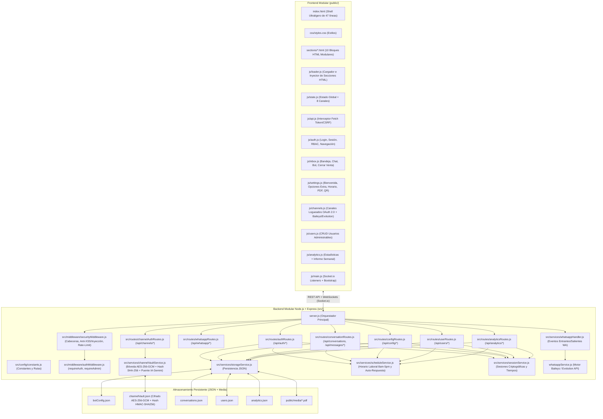

# 📘 Documentación Maestra y Guía de Rollback — OmniPanel Consorcio (Arquitectura Modular)

> [!IMPORTANT]
> **Propósito de este documento:**
> Este manual técnico documenta de forma explícita toda la arquitectura modular del **OmniPanel Consorcio (Agropower & Tractopower)**, cómo construir el panel desde cero, qué hace cada sección visual y lógica, qué elementos contiene, qué módulo la gobierna, cuáles son sus endpoints exactos y cómo realizar un **rollback inmediato** ante cualquier eventualidad.
> **Regla de mantenimiento:** Cada vez que se cree, modifique o actualice una función u opción del panel, este documento se actualizará en su sección correspondiente y en la **Bitácora de Versiones y Rollback (Sección 6)**.

---

## 1. Arquitectura General y Estructura Modular del Proyecto

El sistema dejó de ser monolítico y está dividido en **capas modulares independientes** tanto en el **Backend (`src/`)** como en el **Frontend (`public/js/` y `public/css/`)**, garantizando escalabilidad, mantenibilidad y aislamiento de fallos.



### 1.1. Árbol de Archivos del Proyecto (`omnipanel-consorcio/`)

```text
omnipanel-consorcio/
├── server.js                          # Punto de entrada del servidor HTTP + Socket.io (~76 líneas)
├── whatsappService.js                 # Motor de conexión WhatsApp QR (Baileys integrado / Evolution API)
├── package.json                       # Dependencias y scripts de ejecución
├── botConfig.json                     # Configuración de bienvenida, opciones personalizadas, horario, empresas y plantillas
├── channelVault.json                  # Bóveda criptográfica de canales (AES-256-GCM + Hash HMAC-SHA256, cero texto plano)
├── conversations.json                 # Base de datos de conversaciones reales activas
├── users.json                         # Base de datos de usuarios (Admin principal + asesores administrables)
├── analytics.json                     # Registro histórico de eventos de atención, sesiones y ventas cerradas
├── docs/
│   └── DOCUMENTACION_MAESTRA_OMNIPANEL.md  # Esta documentación técnica maestra y guía de rollback
├── src/                               # CAPA BACKEND MODULAR
│   ├── config/
│   │   └── constants.js               # Constantes globales, rutas de archivos, canales y mensaje de bienvenida base
│   ├── middleware/
│   │   ├── securityMiddleware.js      # Cabeceras HTTP (CSP/HSTS), sanitización Anti-XSS/NoSQL/HPP y Rate Limiters
│   │   └── authMiddleware.js          # Middlewares requireAuth (sesión activa) y requireAdmin (exclusivo Admin)
│   ├── services/
│   │   ├── storageService.js          # Lectura/escritura atómica de JSONs y utilidades de empresa/canal
│   │   ├── channelVaultService.js     # Bóveda Criptográfica (AES-256-GCM + SHA-256) para OAuth 2.0, Baileys/Evolution y Puente IA Gemini
│   │   ├── scheduleService.js         # Cálculo de horario laboral (08:00 a 17:00) y selección de auto-respuesta
│   │   ├── sessionService.js          # Sesiones en memoria, hash timing-safe y conteo de tiempo de conexión de asesores
│   │   └── whatsappHandler.js         # Recepción de mensajes de WhatsApp en tiempo real y disparo del bot fuera de horario
│   └── routes/
│       ├── authRoutes.js              # Endpoints de Login, Logout, Verificación de sesión y Heartbeat
│       ├── whatsappRoutes.js          # Endpoints de estado QR, reinicio y desvinculación de WhatsApp
│       ├── conversationRoutes.js      # Endpoints de chats, envío de mensajes, simulador, pausa de bot y cierre de venta
│       ├── configRoutes.js            # Endpoints de plantillas, bienvenida, horario laboral y subida/borrado de PDF
│       ├── channelAuthRoutes.js       # Endpoints de login OAuth 2.0 (IG/TK/FB) y conexión Baileys/Evolution (WA) con Zero-Leak HTTP
│       ├── userRoutes.js              # Endpoints CRUD de usuarios (Crear, Listar, Modificar, Eliminar)
│       └── analyticsRoutes.js         # Endpoint de consolidación de estadísticas diarias/semanales e informe ejecutivo
└── public/                            # CAPA FRONTEND MODULAR
    ├── index.html                     # Shell raíz ultraligero (47 líneas) con puntos de montaje (#mount-*)
    ├── css/
    │   └── styles.css                 # Estilos personalizados y scrollbars
    ├── sections/                      # BLOQUES HTML MODULARES POR SECCIÓN
    │   ├── login.html                 # Bloque 1: Pantalla de Login Seguro (#loginScreenOverlay)
    │   ├── header.html                # Bloque 2: Barra Superior de Navegación y Estado de Sesión (#mainHeader)
    │   ├── inbox.html                 # Bloque 3: Bandeja Omnicanal de 8 Canales, Chat y Simulador (#viewInbox)
    │   ├── stats.html                 # Bloque 4: Dashboard de Estadísticas y Modal de Informe Semanal (#viewStats)
    │   ├── settings.html              # Bloque 5: Contenedor de Ajustes (#viewSettings) con 5 sub-puntos de montaje
    │   ├── settings-users.html        # Sub-bloque 5.1: Gestión de Usuarios Administrables y Admin
    │   ├── settings-companies.html    # Sub-bloque 5.2: Empresas y Canales Logueados (OAuth 2.0 + Baileys/Evolution + Modal)
    │   ├── settings-whatsapp.html     # Sub-bloque 5.3: Vinculación WhatsApp QR y Modo de Conexión
    │   ├── settings-schedule.html     # Sub-bloque 5.4: Horario Laboral (8am-5pm) y Respuesta Automática
    │   └── settings-templates.html    # Sub-bloque 5.5: Mensaje de Bienvenida, Nuevas Opciones, Plantillas y PDF
    ├── media/                         # Carpeta donde se almacena el Catálogo PDF oficial subido desde la PC
    └── js/                            # LÓGICA JAVASCRIPT MODULAR POR RESPONSABILIDAD
        ├── state.js                   # Estado global reactivo, metadatos de los 8 canales y constantes UI
        ├── api.js                     # Interceptor seguro de window.fetch (adjunta Bearer Token y CSRF Token)
        ├── loader.js                  # Cargador asíncrono que inyecta public/sections/*.html en public/index.html
        ├── auth.js                    # Lógica de Login, bloqueo por Rate-Limit, RBAC por rol y cambio de vistas
        ├── inbox.js                   # Lógica de Bandeja de Entrada, renderizado de chats, envío rápido y Cerrar Venta
        ├── settings.js                # Lógica de Ajustes, Mensaje de Bienvenida, Constructor de Opciones, Horario, PDF y QR
        ├── channels.js                # Lógica de Canales Logueados (OAuth 2.0 para IG/TK/FB y Baileys/Evolution para WA)
        ├── users.js                   # Lógica de creación, edición y eliminación de usuarios administrables
        ├── analytics.js               # Lógica del Dashboard de Estadísticas y Modal de Informe Semanal Ejecutivo
        └── main.js                    # Orquestador de arranque (await loadModularSections -> Socket.io -> initAuthSession)
```

---

## 2. Guía Explícita para Construir e Iniciar el Panel desde Cero

### 2.1. Requisitos del Sistema
- **Node.js:** versión `18.x` o superior (probado en `v24.16.0`).
- **Gestor de paquetes:** `npm`.
- **Sistema Operativo:** Windows, Linux o macOS.

### 2.2. Dependencias (`package.json`)
Para construir el proyecto desde cero en una carpeta limpia:
```bash
npm init -y
npm install express socket.io cors dotenv axios qrcode @whiskeysockets/baileys pino
```

El archivo `package.json` debe contener:
```json
{
  "name": "omnipanel-consorcio",
  "version": "2.0.0",
  "description": "Panel Omnicanal Modular para Consorcio Agropower & Tractopower",
  "main": "server.js",
  "scripts": {
    "start": "node server.js"
  },
  "dependencies": {
    "@whiskeysockets/baileys": "^6.7.16",
    "axios": "^1.7.9",
    "cors": "^2.8.5",
    "dotenv": "^16.4.7",
    "express": "^4.21.2",
    "pino": "^9.6.0",
    "qrcode": "^1.5.4",
    "socket.io": "^4.8.1"
  }
}
```

### 2.3. Comandos de Verificación y Puesta en Marcha
1. **Verificar sintaxis de todos los módulos Backend y Frontend:**
   ```powershell
   node -c server.js
   node -c src/config/constants.js
   node -c src/middleware/securityMiddleware.js
   node -c src/middleware/authMiddleware.js
   node -c src/services/storageService.js
   node -c src/services/scheduleService.js
   node -c src/services/sessionService.js
   node -c src/services/whatsappHandler.js
   node -c src/routes/authRoutes.js
   node -c src/routes/whatsappRoutes.js
   node -c src/routes/conversationRoutes.js
   node -c src/routes/configRoutes.js
   node -c src/routes/userRoutes.js
   node -c src/routes/analyticsRoutes.js
   ```
2. **Iniciar el servidor en vivo:**
   ```powershell
   node server.js
   ```
3. **Acceder desde el navegador:**
   Abrir `http://localhost:3000` (o `http://localhost:3000/login`).

---

## 3. Documentación Explícita por Sección del Panel

A continuación se detalla cada sección del sistema: **qué hace**, **qué elementos contiene**, **qué archivos la controlan**, **cuál es su endpoint** y **cómo funciona internamente**.

---

### SECCIÓN 1: Página de Login Seguro y Control de Acceso (`#loginScreenOverlay`)

- **¿Qué hace?**
  Bloquea el acceso a todo el panel hasta que el usuario se autentique con credenciales válidas. Inicia el registro de estadísticas de sesión **únicamente si quien ingresa es un Asesor (`operator`)**, manteniendo al usuario **Administrador (`admin`) exento de estadísticas**.
- **¿Qué elementos lleva en la interfaz?**
  - Campo ` Nombre de Usuario` (`#loginUsername`) con validación de caracteres seguros (`^[a-zA-Z0-9._-]+$`).
  - Campo `Contraseña` (`#loginPassword`) con botón mostrar/ocultar (`#loginPwdEyeIcon`).
  - Caja de alertas de error y cuenta regresiva de bloqueo por fuerza bruta (`#loginErrorBox`).
  - Botón `Iniciar Sesión en el Panel` (`#btnLoginSubmit`).
- **Módulos que la gobiernan:**
  - **Frontend:** `public/js/auth.js` (`submitLoginForm`, `startLockoutCountdown`, `initAuthSession`, `onAuthenticatedSuccess`) y `public/js/api.js` (interceptor Fetch).
  - **Backend:** `src/routes/authRoutes.js`, `src/middleware/securityMiddleware.js`, `src/services/sessionService.js`.
- **Endpoints asociados:**
  - `POST /api/auth/login` — Valida credenciales en tiempo constante (`crypto.timingSafeEqual`), aplica Rate Limit (máx. 5 intentos fallidos / 15 min de bloqueo por IP), emite Cookie `HttpOnly; SameSite=Strict` (`omnipanel_sid`) + `token` Bearer de 256 bits + `csrfToken`.
  - `GET /api/auth/me` — Verifica si existe una sesión activa al recargar la página.
  - `POST /api/auth/heartbeat` — Se ejecuta cada 45 segundos desde el cliente para actualizar el tiempo de conexión en vivo de los asesores.
  - `POST /api/auth/logout` — Cierra la sesión actual, registra la duración final de conexión del asesor y limpia la cookie.
- **¿Cómo funciona paso a paso?**
  1. Al abrir `http://localhost:3000`, `main.js` invoca `initAuthSession()` que consulta `GET /api/auth/me`.
  2. Si no hay sesión válida, muestra `#loginScreenOverlay` y oculta `#mainHeader`, `#viewInbox`, `#viewStats` y `#viewSettings`.
  3. Al enviar el formulario, `POST /api/auth/login` verifica el Rate Limit de la IP. Si falla 5 veces seguidas, devuelve `HTTP 429` con `retryAfterSeconds` y el frontend activa un temporizador regresivo bloqueando el botón.
  4. Si las credenciales son válidas:
     - Si el usuario **NO es Admin** (`role !== 'admin'`), agrega una entrada en `user.connectionHistory` dentro de `users.json` y un evento `user_login` en `analytics.json`.
     - Si el usuario **ES Admin**, inicia sesión sin alterar `analytics.json` ni `connectionHistory`.

---

### SECCIÓN 2: Barra Superior de Navegación y Control de Roles RBAC (`#mainHeader`)

- **¿Qué hace?**
  Muestra el estado de conexión de WhatsApp en tiempo real, las pestañas de navegación permitidas según el rol del usuario autenticado, el cronómetro de sesión activa y los botones de acción rápida.
- **¿Qué elementos lleva?**
  - Indicador de estado WhatsApp (`#headerWaBadge`: *"WA Conectado"* en verde o *"Escanear QR"* en ámbar).
  - Pestañas de navegación:
    - `Bandeja de Mensajes` (`#navInbox`) — Visible para **todos** los usuarios autenticados.
    - `Estadísticas` (`#navStats`) — Visible **únicamente para el Administrador**.
    - `Ajustes & Usuarios` (`#navSettings`) — Visible **únicamente para el Administrador**.
  - Tarjeta de sesión activa (`#headerAuthUserName` y `#headerAuthStatsStatus`):
    - Si es Asesor: muestra `🟢 Registrando Estadísticas • ⏱️ 00m 15s` en tiempo real.
    - Si es Admin: muestra `🛡️ Modo Admin (Exento de estadísticas)`.
  - Botón `QR` (`#btnQuickQr`, solo Admin), botón `Simular Cliente` y botón `Cerrar Sesión`.
- **Módulos que la gobiernan:**
  - **Frontend:** `public/js/auth.js` (`applyRolePermissions`, `updateHeaderSessionBanner`, `switchView`, `logoutUser`).
  - **Backend:** `src/middleware/authMiddleware.js` (`requireAuth`, `requireAdmin`).

---

### SECCIÓN 3: Bandeja de Entrada Omnicanal de 2 Empresas y 8 Canales (`#viewInbox`)

Está dividida en 3 columnas interactivas:

#### 3.1. Columna Izquierda: Filtros por Empresa/Canal y Lista de Conversaciones (`#leftSidebar`)
- **¿Qué hace?**
  Permite filtrar las conversaciones entrantes por empresa (**🌿 Agropower** o **🚜 Tractopower**) o por cualquiera de los **8 canales individuales**, además de buscar por nombre de cliente o texto.
- **¿Qué lleva?**
  - Botones de filtro global: `Todos (8)` (`#flt_all`), `🌿 Agropower` (`#flt_company_agro`), `🚜 Tractopower` (`#flt_company_tracto`).
  - Bloque **🌿 Agropower**:
    - `wa_agro`: WhatsApp (En prueba)
    - `ig_agro`: Instagram `@agropower_venezuela`
    - `tk_agro`: TikTok `@agropower_venezuela`
    - `fb_agro`: Facebook Messenger (Pendiente)
  - Bloque **🚜 Tractopower**:
    - `wa_tracto`: WhatsApp (En prueba)
    - `ig_tracto`: Instagram `@Tractopower_venezuela`
    - `tk_tracto`: TikTok `@tractopowervenezuela`
    - `fb_tracto`: Facebook Messenger (Pendiente)
  - Buscador instantáneo (`#searchInput`) y contenedor de lista de chats (`#chatListContainer`).
- **Módulo:** `public/js/inbox.js` (`filterChannel`, `renderChatList`, `selectConversation`) y `public/js/state.js` (`channelMeta`).
- **Endpoint:** `GET /api/conversations` (protegido por `requireAuth`).

#### 3.2. Cabecera del Chat Activo: Control del Bot y Botón "Cerrar Venta"
- **¿Qué hace?**
  Muestra la identidad del cliente seleccionado, a qué empresa y canal pertenece, el estado del bot en esa conversación y permite pausar/reactivar el bot o registrar una **Venta Cerrada**.
- **¿Qué lleva?**
  - Iniciales (`#activeAvatar`), Nombre (`#activeName`), Etiqueta de Empresa (`#activeCompanyBadge`), Etiqueta de Canal (`#activeChannelBadge`) e insignia `🏆 VENTA CERRADA` (`#activeSaleClosedBadge`).
  - Indicador de Estado del Bot (`#chatBotStatusBadge`):
    - Cuando `botActive === true`: Fondo verde esmeralda con punto pulsante y texto **"Bot en control de respuestas programadas"**.
    - Cuando `botActive === false`: Fondo ámbar y texto **"Bot: APAGADO (Asesor en control)"**.
  - Botón `Pausar / Reactivar Bot` (`#btnToggleBotChat`):
    - Al presionar **Reactivar Bot**, cambia inmediatamente el estado a `botActive = true`, limpia `waitingAdvisor = false` y pone el indicador superior en verde con el texto **"Bot en control de respuestas programadas"**.
  - Botón **`🏆 Cerrar Venta` / `Venta Cerrada ✓`** (`#btnCloseSale`):
    - Permite al asesor marcar que concretó la venta en esa conversación.
  - Botón **`Enviar Bienvenida`**: Envía en 1 clic el **Mensaje de Bienvenida** (`#t_greeting_menu`).
- **Módulos:** `public/js/inbox.js` (`updateBotHeaderUI`, `toggleActiveChatBot`, `updateSaleButtonUI`, `toggleCloseSale`) y `src/routes/conversationRoutes.js`.
- **Endpoints:**
  - `POST /api/conversations/toggle-bot` — Alterna `botActive` (`true`/`false`) en `conversations.json` y emite `conversations_updated`.
  - `POST /api/conversations/close-sale` — Alterna `saleClosed` en la conversación. Si quien lo pulsa es un asesor (no Admin), registra el evento `sale_closed` (y `client_attended` si no existía) en `analytics.json` con la fecha, hora, empresa, canal y nombre del cliente, emitiendo `analytics_updated`.

#### 3.3. Visor de Mensajes y Consola Inferior de Envío Rápido (3 Categorías + Opciones Extra)
- **¿Qué hace?**
  Renderiza el historial de mensajes del chat activo y permite responder ya sea con **botones de envío rápido de 1 clic** (organizados en las 3 categorías del menú) o escribiendo un mensaje libre.
- **¿Qué lleva?**
  - Visor de burbujas de chat (`#messagesViewport`) con soporte de negritas estilo WhatsApp (`*texto*`) y tarjetas de documento PDF adjunto.
  - Selector de canal de respuesta (`#replyChannelSelect`).
  - **Categoría 1 (`1. Catálogo y Desc. Técnica`):**
    - Botón `Catálogo (PDF)` (`sendPreprogrammed('cat_modelos')`) — Envía el texto de catálogo + el archivo PDF oficial guardado en el servidor.
    - Botón `🔧 Repuestos` (`sendPreprogrammed('repuestos')`).
    - Botón `🛡️ Garantía` (`sendPreprogrammed('garantia')`).
    - Contenedor dinámico `#customBtnsCat1` para botones adicionales creados desde Ajustes.
  - **Categoría 2 (`2. Costos y Financiamiento`):**
    - Botón `💰 Precios` (`sendPreprogrammed('precios')`).
    - Botón `💳 Financiamiento` (`sendPreprogrammed('financiamiento')`).
    - Botón `📦 Compras Prog.` (`sendPreprogrammed('compras_prog')`).
    - Contenedor dinámico `#customBtnsCat2` para botones adicionales creados desde Ajustes.
  - **Categoría 3 (`3. Hablar con un Asesor`):**
    - Botón `Saludo de Asesor` (`sendPreprogrammed('asesor')`).
    - Contenedor dinámico `#customBtnsCat3` para botones adicionales creados desde Ajustes.
  - Campo de texto libre (`#operatorInput`) y botón `Enviar` (`operatorSendMessage()`).
- **¿Cómo funciona al enviar un mensaje?**
  1. Invoca `POST /api/messages/send` con `{ conversationId, text, attachment }`.
  2. El backend identifica al usuario desde su sesión criptográfica (`req.authUser`), apaga automáticamente el bot en ese chat (`conv.botActive = false`) porque un humano tomó el control, y guarda el mensaje con el nombre del asesor.
  3. Si el usuario es un Asesor (no Admin), registra `client_attended` (1 vez por conversación/asesor) y `message_sent` en `analytics.json`.
  4. Si el canal es de WhatsApp (`wa_agro` o `wa_tracto`), envía el mensaje real (o el documento PDF real vía `whatsappService.sendPdf`) al teléfono del cliente a través de Baileys/Evolution API.

#### 3.4. Simulador Omnicanal (`#simulatorPanel`)
- **¿Qué hace?**
  Permite simular la llegada de mensajes de un cliente por cualquiera de los 8 canales de Agropower o Tractopower para probar el comportamiento de las respuestas automáticas y de la bandeja.
- **Endpoint:** `POST /api/messages/simulate`.

---

### SECCIÓN 4: Vista de Estadísticas e Informe Semanal Ejecutivo (`#viewStats` y `#weeklyReportModal`)

- **¿Qué hace?**
  Exclusiva para el **Administrador Principal**. Muestra en tiempo real el rendimiento diario y semanal de todos los asesores administrables, el movimiento por cada una de las 2 empresas (**Agropower** y **Tractopower**) y sus **8 canales**, qué canal fue el más movido, cuál cerró más ventas, los horarios de entrada/permanencia de cada asesor en el panel y genera el **Informe Semanal Ejecutivo imprimible/PDF**.
- **¿Qué elementos lleva?**
  - **4 Tarjetas KPI Superiores:**
    1. `Clientes Atendidos` (Total semana + Hoy).
    2. `Ventas Cerradas 🏆` (Total semana + Hoy + % de Efectividad/Conversión).
    3. `Canal Más Movido 🔥` (Canal con mayor volumen de clientes atendidos).
    4. `Canal con Más Cierres 💰` (Canal líder en ventas cerradas).
  - **Desglose por Empresa y sus 8 Canales (`#statsCompaniesBanner` y `#statsChannelsGrid`):** Comparativa directa entre Agropower y Tractopower y tarjetas con barra de progreso para los 8 canales (`wa_agro`, `ig_agro`, `tk_agro`, `fb_agro`, `wa_tracto`, `ig_tracto`, `tk_tracto`, `fb_tracto`).
  - **Tabla de Rendimiento Detallado por Usuario (`#statsUsersTableBody`):** Muestra cada asesor, su estado (`En línea` / desconectado), hora de último ingreso, clientes atendidos Hoy, desglose en cada uno de los 8 canales, total semanal, mensajes enviados y ventas cerradas con porcentaje de efectividad.
  - **Auditoría de Horarios de Conexión al Panel (`#statsConnectionLogs`):** Historial de sesiones de cada asesor con fecha, hora de entrada, última actividad y duración acumulada.
  - **Registro de Ventas Cerradas (`#statsClosedSalesList`):** Bitácora en tiempo real de cada venta cerrada (cliente, asesor que la cerró, empresa, canal, fecha y hora).
  - **Modal de Informe Semanal Ejecutivo (`#weeklyReportModal`):** Reporte consolidado listo para imprimir o guardar en PDF (`window.print()`).
- **Módulos:** `public/js/analytics.js` y `src/routes/analyticsRoutes.js`.
- **Endpoint:** `GET /api/analytics/summary` (protegido con `requireAuth` + `requireAdmin`).

---

### SECCIÓN 5: Vista de Ajustes del Panel (`#viewSettings` — Exclusivo Administrador)

Consta de **6 subsecciones modulares**:

#### 5.1. Gestión de Usuarios del Panel (Administrador y Usuarios Administrables)
- **¿Qué hace?**
  Permite al Administrador Principal crear todos los usuarios asesores que desee, colocando **Nombre, Apellido, Correo, Nombre de Usuario, Clave y Rol**, así como ver toda esta información (incluidas las claves) en una tabla y modificarla o eliminar usuarios en cualquier momento.
- **Módulos:** `public/js/users.js` y `src/routes/userRoutes.js`.
- **Endpoints:**
  - `GET /api/users` — Lista todos los usuarios registrados.
  - `POST /api/users` — Crea un nuevo usuario en `users.json`.
  - `PUT /api/users/:id` — Modifica nombre, apellido, correo, usuario, clave o rol de un usuario existente.
  - `DELETE /api/users/:id` — Elimina un usuario (protege al Administrador Principal `id: 1` contra borrado accidental).

#### 5.2. Pasarela WhatsApp QR Multi-Dispositivo
- **¿Qué hace?**
  Muestra el código QR en tiempo real para vincular el teléfono WhatsApp del consorcio, indica el número conectado actualmente y permite reiniciar o desvincular la sesión para cambiar de número.
- **Módulos:** `public/js/settings.js` (`checkWhatsAppStatus`, `updateWhatsAppUI`, `restartWhatsAppConnection`, `logoutWhatsApp`), `src/routes/whatsappRoutes.js` y `whatsappService.js`.
- **Endpoints:**
  - `GET /api/whatsapp/status`
  - `POST /api/whatsapp/restart`
  - `POST /api/whatsapp/logout`

#### 5.3. Empresas y Canales Omnicanal con OAuth 2.0 Oficial en Vivo + Baileys con Evolution API + Puente IA Gemini
- **¿Qué hace?**
  Gestiona la autenticación **100% real (cero simulaciones ni pre-logins falsos)** de los **8 canales del consorcio** (**Agropower** y **Tractopower**):
  - **3 Redes Sociales por empresa (`ig_agro`, `tk_agro`, `fb_agro` y `ig_tracto`, `tk_tracto`, `fb_tracto`):** Autenticadas mediante **OAuth 2.0 Oficial** directamente contra los endpoints de inicio de sesión, intercambio de código y verificación de perfil de cada red social:
    1. **Instagram (`ig_agro`, `ig_tracto`):**
       - *Instagram Login Directo:* Authorize `https://www.instagram.com/oauth/authorize` → Token Exchange `POST https://api.instagram.com/oauth/access_token` + Long-Lived Token `GET https://graph.instagram.com/access_token` → Verificación de Perfil Real `GET https://graph.instagram.com/v21.0/me?fields=id,user_id,username,name,account_type`.
       - *Meta Facebook Login for Business:* Authorize `https://www.facebook.com/v21.0/dialog/oauth` → Token Exchange `GET https://graph.facebook.com/v21.0/oauth/access_token` → Verificación de Perfil e Instagram Business Account `GET https://graph.facebook.com/v21.0/me?fields=id,name,accounts{id,name,access_token,instagram_business_account{id,username,name}}`.
    2. **TikTok (`tk_agro`, `tk_tracto` — Login Kit v2 + PKCE S256):**
       - Authorize `https://www.tiktok.com/v2/auth/authorize/` (con `code_challenge` `S256`) → Token Exchange `POST https://open.tiktokapis.com/v2/oauth/token/` → Verificación de Perfil Real `GET https://open.tiktokapis.com/v2/user/info/?fields=open_id,union_id,avatar_url,display_name,username`.
    3. **Facebook Messenger (`fb_agro`, `fb_tracto` — Meta Graph API v21.0):**
       - Authorize `https://www.facebook.com/v21.0/dialog/oauth` → Token Exchange `GET https://graph.facebook.com/v21.0/oauth/access_token` → Verificación de Perfil y Páginas `GET https://graph.facebook.com/v21.0/me?fields=id,name,accounts{id,name,access_token,category}`.
  - **1 WhatsApp por empresa (`wa_agro` y `wa_tracto`):** Conectados mediante **Baileys Multi-Dispositivo Integrado** (verificando en vivo el socket activo y la huella SHA-256 de `auth_info_baileys/creds.json`) o mediante **Servidor Evolution API Externo** (verificando en vivo `GET ${evolutionUrl}/instance/connectionState/${instanceName}`).
- **Puente Directo para IA (Gemini / Agentes Autónomos):**
  Cuando un canal ha sido genuinamente verificado contra la API oficial (`connected: true` y `verifiedByProvider: true`), cualquier integración de IA en el servidor (como **Gemini**) puede invocar internamente `getInternalChannelSessionForAI(channelKey)` en `src/services/channelVaultService.js` para obtener los tokens desencriptados en memoria RAM y operar **sin pedirle más datos al usuario**.
- **Seguridad Criptográfica y Política Zero-Leak HTTP (Cero Fuga de Credenciales al Exterior):**
  1. **Cifrado Autenticado en Reposo (`AES-256-GCM`):** Los secretos (`clientSecret`, `accessToken`, `refreshToken`, `pageAccessToken`, `evolutionApiKey`) se cifran con llave maestra de 256 bits en `channelVault.json`.
  2. **Huella Hash Irreversible (`HMAC-SHA256`):** Cada credencial verificada genera una huella `credentialHash` (`sha256:...`).
  3. **Zero-Leak HTTP:** Ningún endpoint HTTP devuelve jamás `encryptedCredentials` ni tokens en texto plano al navegador.
- **Módulos que la gobiernan:**
  - **Frontend:** `public/sections/settings-companies.html` y `public/js/channels.js`.
  - **Backend:** `src/services/channelVaultService.js`, `src/routes/channelAuthRoutes.js` y `src/middleware/securityMiddleware.js` (`Cross-Origin-Opener-Policy: same-origin-allow-popups`).
- **Endpoints asociados:**
  - `GET /api/channels/auth-state` — Devuelve el estado sanitizado de los 8 canales, especificaciones de endpoints oficiales y hashes `sha256:...`.
  - `POST /api/channels/oauth/save-app` — Guarda cifrados el `clientId` y `clientSecret` de la App de Desarrollador sin simular login.
  - `POST /api/channels/oauth/start` — Genera la URL oficial de autorización OAuth 2.0 + PKCE (`S256`) y `state` anti-CSRF para abrir la ventana emergente de login en `instagram.com`, `tiktok.com` o `facebook.com`.
  - `GET /api/channels/oauth/callback` — Recibe `code` y `state` desde la red social, realiza el canje `code -> access_token` contra el servidor oficial, verifica el perfil real, guarda los tokens cifrados en `channelVault.json` y notifica a la ventana principal vía `postMessage` y Socket.io.
  - `POST /api/channels/connect-oauth` — Verifica en vivo un `accessToken` contra `graph.instagram.com/v21.0/me`, `open.tiktokapis.com/v2/user/info/` o `graph.facebook.com/v21.0/me`; rechaza con `401` cualquier token falso o inválido.
  - `POST /api/channels/verify-session` — Re-verifica en vivo contra la API oficial que el token guardado sigue activo.
  - `POST /api/channels/connect-whatsapp` — Verifica y vincula la sesión Baileys QR o instancia Evolution API.
  - `POST /api/channels/disconnect` — Revoca la sesión del canal y limpia sus tokens de acceso en `channelVault.json`.

#### 5.4. Programación de Horario Laboral (8:00 AM a 5:00 PM) y Regla de Respuestas Automáticas
- **¿Qué hace?**
  Estipula el horario laboral (por defecto `08:00` a `17:00`) y la regla en que el bot responde automáticamente.
  - Por defecto está en modo **`outside_work_hours` (Activar respuestas automáticas SOLO FUERA del horario laboral)**:
    - Dentro de `08:00` a `17:00`: El bot permanece en pausa para que los asesores atiendan personalmente.
    - Fuera de `08:00` a `17:00` (o en modo 24h): Escriba lo que escriba el cliente de primero (*"Precio"*, *"Catálogo"*, *"Hola"*, etc.), el sistema envía automáticamente el **Mensaje de Bienvenida** configurado (`autoReplySource: "greeting_menu"`), o bien el saludo corto fuera de horario o ambos según se seleccione en `#autoReplySourceInput`.
- **Módulos:** `src/services/scheduleService.js` (`evaluateSchedule`, `getAutoReplyMessage`) y `public/js/settings.js` (`previewScheduleState`).
- **Endpoint:** `GET /api/config/templates` y `POST /api/config/templates`.

#### 5.5. Gestión del Catálogo Oficial en PDF desde la PC (`Catalogo_Oficial_2026.pdf`)
- **¿Qué hace?**
  Permite seleccionar un archivo `.pdf` desde la PC del Administrador, validarlo mediante su firma binaria mágica (`%PDF-`), guardarlo en el servidor (`public/media/`), visualizarlo, borrarlo o sustituirlo por otro PDF nuevo en cualquier momento.
- **Módulos:** `public/js/settings.js` (`checkCatalogPdfStatus`, `handlePdfFileSelected`, `deleteCatalogPdf`) y `src/routes/configRoutes.js`.
- **Endpoints:**
  - `GET /api/config/catalog-pdf` — Devuelve `{ exists, fileName, sizeBytes, url }`.
  - `POST /api/config/catalog-pdf` — Recibe `{ fileName, fileBase64 }`, elimina el PDF anterior si existía, guarda el nuevo en `public/media/` y actualiza `botConfig.json`.
  - `DELETE /api/config/catalog-pdf` — Elimina el archivo PDF físico de `public/media/` y limpia la referencia en `botConfig.json`.

#### 5.6. Mensajes Programados de Envío Rápido, Mensaje de Bienvenida y Modales para Agregar Categorías y Opciones
- **¿Qué hace?**
  Contiene todos los mensajes preprogramados del panel, incluyendo el editor del **Mensaje de Bienvenida** y los **2 Modales interactivos** para expandir el menú con nuevas categorías y nuevas opciones:
  1. **Bloque del Mensaje de Bienvenida (`#t_greeting_menu`):**
     Preconfigurado con el menú oficial de 3 bloques:
     ```text
     👋 *¡Hola! Bienvenido a nuestra central de atención.*
     Selecciona qué información deseas recibir:

     📘 *1. CATÁLOGO Y DESC. TÉCNICA*
      • Catálogo de modelos (PDF)
      • Repuestos
      • Garantía

     💵 *2. COSTOS Y FINANCIAMIENTO*
      • Precio de los modelos
      • Sistema de financiamiento
      • Compras programadas

     🧑‍💼 *3. HABLAR CON UN ASESOR*
     ```
     Este mensaje se envía **siempre** como respuesta automática inicial (escriba lo que escriba el cliente de primero) y también al pulsar el botón **"Enviar Bienvenida"** en el chat.
  2. **Modal para Agregar Nueva Categoría (`#addCategoryModal` — `openAddCategoryModal()`):**
     Disponible tanto desde el bloque de *Horario y Respuestas Automáticas* (`public/sections/settings-schedule.html`) como desde el bloque del *Mensaje de Bienvenida* (`public/sections/settings-templates.html`). Permite crear una nueva categoría completa indicando:
     - **Icono / Emoji** (`#modalCatEmoji` + barra de emojis sugeridos `🔧`, `📍`, `🚜`, `📦`, `🛠️`, `📋`, `⭐`, `🌾`).
     - **Número de Categoría** (`#modalCatNumber`, autocalculado ej. `4`, `5`...).
     - **Nombre de la Categoría** (`#modalCatTitle`, con vista previa en vivo `#modalCatPreview`, ej. `🔧 *4. SERVICIO TÉCNICO Y POSTVENTA*`).
     - **Color en Consola de Asesor** (`#modalCatColor`).
     - **Opcional: Primera Opción Inicial** (`#modalCatFirstOptTitle` y `#modalCatFirstOptReply`) para inaugurar la categoría con su primera viñeta y botón rápido en un solo paso.
     Al guardar (`submitAddCategoryModal`):
     - Inserta el nuevo bloque de categoría al final del **Mensaje de Bienvenida** (`#t_greeting_menu`).
     - Agrega la categoría al selector desplegable de categorías (`#modalOptCategory` y `#newOptCategory`).
     - Crea su tarjeta visual de botones rápidos en la **Bandeja de Entrada** (`#customCategoriesInboxGrid`) y en la lista de Ajustes (`#customCategoriesSettingsList`).
     - Persiste automáticamente en `botConfig.json` (`customCategories`).
  3. **Modal para Agregar Nueva Opción (`#addOptionModal` — `openAddOptionModal()`):**
     Permite agregar cualquier opción nueva seleccionando su categoría (cualquiera de las 3 categorías base o cualquiera de las **categorías personalizadas** creadas), su título (`#modalOptTitle`) y su respuesta rápida (`#modalOptReply`). Al agregarla (`submitAddOptionModal`):
     - Se inserta automáticamente la viñeta ` • <Título>` dentro del **Mensaje de Bienvenida** exactamente debajo de la categoría elegida.
     - Se crea automáticamente un **botón de envío rápido de 1 clic** en la Bandeja de Entrada (`#customBtnsCat1`, `#customBtnsCat2`, `#customBtnsCat3` o `#customBtns_<catId>`).
     - Se puede editar o eliminar en cualquier momento desde `#customOptionsSettingsList`.
  4. **Plantillas de las 3 Categorías Base:**
     - Categoría 1: `#t_cat_modelos`, `#t_repuestos`, `#t_garantia`.
     - Categoría 2: `#t_precios`, `#t_financiamiento`, `#t_compras_prog`.
     - Categoría 3: `#t_asesor`.
- **Módulos:** `public/sections/settings-templates.html`, `public/sections/settings-schedule.html`, `public/sections/inbox.html`, `public/js/settings.js` y `src/routes/configRoutes.js`.
- **Endpoint:** `POST /api/config/templates` (persiste `greeting`, `customCategories`, `customOptions`, `schedule`, `companies`, `categories` en `botConfig.json` y emite `config_updated` por Socket.io).

---

## 4. Catálogo Completo de Endpoints REST y Eventos WebSocket

### 4.1. Tabla Maestra de Endpoints REST

| Método | Endpoint | Módulo Backend | Permiso Requerido | Descripción Funcional |
| :--- | :--- | :--- | :--- | :--- |
| `POST` | `/api/auth/login` | `src/routes/authRoutes.js` | Público (con Rate Limit 5 int/15m) | Autentica usuario, crea sesión criptográfica e inicia métricas si es asesor. |
| `GET` | `/api/auth/me` | `src/routes/authRoutes.js` | `requireAuth` | Verifica sesión activa y devuelve datos del usuario y token CSRF. |
| `POST` | `/api/auth/heartbeat` | `src/routes/authRoutes.js` | `requireAuth` | Actualiza duración de conexión activa del asesor cada 45s. |
| `POST` | `/api/auth/logout` | `src/routes/authRoutes.js` | Sesión / Público | Cierra sesión, guarda duración final del asesor y limpia cookie `omnipanel_sid`. |
| `GET` | `/api/whatsapp/status` | `src/routes/whatsappRoutes.js` | `requireAuth` | Devuelve estado de conexión WhatsApp (`connected`, `qr_ready`, `connecting`), QR en base64 y número vinculado. |
| `POST` | `/api/whatsapp/config` | `src/routes/whatsappRoutes.js` | `requireAuth` + `requireAdmin` | Cambia modo de motor WhatsApp (`integrated` Baileys vs `evolution` API). |
| `POST` | `/api/whatsapp/restart` | `src/routes/whatsappRoutes.js` | `requireAuth` + `requireAdmin` | Reinicia el socket de WhatsApp para generar un nuevo QR. |
| `POST` | `/api/whatsapp/logout` | `src/routes/whatsappRoutes.js` | `requireAuth` + `requireAdmin` | Desvincula el WhatsApp actual y limpia credenciales de sesión WA. |
| `GET` | `/api/conversations` | `src/routes/conversationRoutes.js` | `requireAuth` | Devuelve el arreglo de conversaciones activas desde `conversations.json`. |
| `POST` | `/api/messages/send` | `src/routes/conversationRoutes.js` | `requireAuth` | Envía mensaje o PDF al cliente, pasa el chat a control de asesor (`botActive: false`) y registra métrica si es asesor. |
| `POST` | `/api/messages/simulate` | `src/routes/conversationRoutes.js` | `requireAuth` | Simula mensaje entrante de cliente y dispara auto-respuesta si aplica según horario. |
| `POST` | `/api/conversations/toggle-bot` | `src/routes/conversationRoutes.js` | `requireAuth` | Pausa o reactiva el bot (`botActive`) en la conversación seleccionada. |
| `POST` | `/api/conversations/close-sale` | `src/routes/conversationRoutes.js` | `requireAuth` | Marca o desmarca `saleClosed` (Venta Cerrada) y registra la venta en `analytics.json` (si no es Admin). |
| `GET` | `/api/config/templates` | `src/routes/configRoutes.js` | `requireAuth` | Devuelve `botConfig.json` completo + `scheduleStatus` evaluado en tiempo real. |
| `POST` | `/api/config/templates` | `src/routes/configRoutes.js` | `requireAuth` + `requireAdmin` | Guarda Mensaje de Bienvenida (`greeting`), `customCategories`, `customOptions`, `schedule`, `companies` y `categories`. |
| `GET` | `/api/config/catalog-pdf` | `src/routes/configRoutes.js` | `requireAuth` | Consulta si existe el PDF del catálogo en `public/media/` y su tamaño/URL. |
| `POST` | `/api/config/catalog-pdf` | `src/routes/configRoutes.js` | `requireAuth` + `requireAdmin` | Valida firma `%PDF-`, guarda el PDF subido en `public/media/` y sustituye el anterior. |
| `DELETE` | `/api/config/catalog-pdf` | `src/routes/configRoutes.js` | `requireAuth` + `requireAdmin` | Elimina el archivo PDF del catálogo de `public/media/`. |
| `GET` | `/api/channels/auth-state` | `src/routes/channelAuthRoutes.js` | `requireAuth` | Devuelve el estado verificado de los 8 canales, endpoints oficiales OAuth 2.0 y hash `sha256:...` (**Zero-Leak HTTP**). |
| `POST` | `/api/channels/oauth/save-app` | `src/routes/channelAuthRoutes.js` | `requireAuth` + `requireAdmin` | Guarda cifrados en la bóveda el `clientId` y `clientSecret` de la App de Desarrollador de Meta o TikTok. |
| `POST` | `/api/channels/oauth/start` | `src/routes/channelAuthRoutes.js` | `requireAuth` + `requireAdmin` | Genera la URL oficial de login OAuth 2.0 + PKCE (`instagram.com`, `tiktok.com`, `facebook.com`) y abre el flujo de autorización real. |
| `GET` | `/api/channels/oauth/callback` | `src/routes/channelAuthRoutes.js` | Callback OAuth Público (Validado por `state` + PKCE) | Recibe `code` de la red social, intercambia por `access_token` oficial, verifica el perfil en Graph/Open API, cifra en `channelVault.json` y cierra el popup. |
| `POST` | `/api/channels/connect-oauth` | `src/routes/channelAuthRoutes.js` | `requireAuth` + `requireAdmin` | Verifica en vivo un `accessToken` contra `graph.instagram.com/v21.0/me`, `open.tiktokapis.com/v2/user/info/` o `graph.facebook.com/v21.0/me` y guarda cifrado si es auténtico. |
| `POST` | `/api/channels/verify-session` | `src/routes/channelAuthRoutes.js` | `requireAuth` + `requireAdmin` | Re-verifica en vivo contra el servidor oficial de la red social que la sesión guardada sigue activa. |
| `POST` | `/api/channels/connect-whatsapp` | `src/routes/channelAuthRoutes.js` | `requireAuth` + `requireAdmin` | Verifica en vivo y cifra (`AES-256-GCM` + `HMAC-SHA256`) la sesión Baileys QR o instancia Evolution API de WhatsApp. |
| `POST` | `/api/channels/disconnect` | `src/routes/channelAuthRoutes.js` | `requireAuth` + `requireAdmin` | Revoca la sesión logueada de un canal y limpia sus tokens de acceso de `channelVault.json`. |
| `GET` | `/api/users` | `src/routes/userRoutes.js` | `requireAuth` + `requireAdmin` | Devuelve la lista completa de usuarios de `users.json`. |
| `POST` | `/api/users` | `src/routes/userRoutes.js` | `requireAuth` + `requireAdmin` | Crea un nuevo usuario asesor o administrador. |
| `PUT` | `/api/users/:id` | `src/routes/userRoutes.js` | `requireAuth` + `requireAdmin` | Modifica datos, usuario, clave o rol de un usuario existente. |
| `DELETE` | `/api/users/:id` | `src/routes/userRoutes.js` | `requireAuth` + `requireAdmin` | Elimina un usuario administrable (excepto Admin Principal `id: 1`). |
| `GET` | `/api/analytics/summary` | `src/routes/analyticsRoutes.js` | `requireAuth` + `requireAdmin` | Calcula KPIs diarios/semanales, métricas por empresa/canal, tabla por asesor y ventas cerradas (excluyendo al Admin). |

### 4.2. Eventos WebSocket (`Socket.io`) en Tiempo Real

| Evento Socket.io | Emisor | Receptor (`public/js/main.js`) | Acción que desencadena |
| :--- | :--- | :--- | :--- |
| `whatsapp_status_update` | `whatsappService.js` | `updateWhatsAppUI(data)` | Actualiza el QR, estado de conexión y número de teléfono en la cabecera y en Ajustes. |
| `conversations_updated` | `whatsappHandler.js` / `conversationRoutes.js` | `renderChatList()`, `renderMessages()` | Actualiza instantáneamente la lista de chats, mensajes nuevos, estado del bot y botón de venta cerrada. |
| `users_updated` | `authRoutes.js` / `userRoutes.js` | `renderSettingsUsersTable()` | Actualiza la tabla de usuarios y estado `En línea` en la vista del Administrador. |
| `analytics_updated` | `authRoutes.js` / `conversationRoutes.js` / `userRoutes.js` | `loadAnalyticsSummary()` | Refresca en vivo los KPIs, canales y tabla de estadísticas del Administrador. |
| `config_updated` | `configRoutes.js` | `applyConfigToUI(updatedConfig)` | Sincroniza plantillas, Mensaje de Bienvenida y botones de opciones personalizadas en todos los paneles abiertos. |
| `channels_auth_updated` | `channelAuthRoutes.js` | `renderChannelsVaultUI(updatedVault)` | Actualiza en vivo las tarjetas de los 8 canales verificados (OAuth 2.0 Oficial / Baileys+Evolution) y el contador del Puente IA Gemini. |

---

## 5. Esquemas de Archivos de Persistencia (Plantillas Base para Restauración)

Si algún archivo JSON se corrompe o se desea restablecer a su configuración limpia de fábrica, utiliza exactamente las siguientes estructuras:

### 5.1. `botConfig.json` (Estado Base Funcional)
```json
{
  "greeting": "👋 *¡Hola! Bienvenido a nuestra central de atención.*\nSelecciona qué información deseas recibir:\n\n📘 *1. CATÁLOGO Y DESC. TÉCNICA*\n • Catálogo de modelos (PDF)\n • Repuestos\n • Garantía\n\n💵 *2. COSTOS Y FINANCIAMIENTO*\n • Precio de los modelos\n • Sistema de financiamiento\n • Compras programadas\n\n🧑‍💼 *3. HABLAR CON UN ASESOR*",
  "customCategories": [],
  "customOptions": [],
  "schedule": {
    "workStart": "08:00",
    "workEnd": "17:00",
    "mode": "outside_work_hours",
    "autoReplySource": "greeting_menu",
    "welcomeMessage": "Feliz dia estimado cliente, gracias por contactarnos, en un momento un asesor se pondra en contacto con usted para brindarle toda la informacion que desea, gracias por su paciencia, Su consulta es muy importante para nosotros."
  },
  "testWhatsappChannel": "wa_agro",
  "companies": {
    "agropower": {
      "name": "Agropower",
      "instagram": "agropower_venezuela",
      "tiktok": "agropower_venezuela",
      "facebook": "Pendiente por configurar",
      "whatsapp": "Pendiente por configurar (Usando WhatsApp de prueba)"
    },
    "tractopower": {
      "name": "Tractopower",
      "instagram": "Tractopower_venezuela",
      "tiktok": "tractopowervenezuela",
      "facebook": "Pendiente por configurar",
      "whatsapp": "Pendiente por configurar (Usando WhatsApp de prueba)"
    }
  },
  "categories": {
    "catalogo_tecnico": {
      "title": "Catálogo y Descripción Técnica",
      "items": {
        "cat_modelos": {
          "title": "Catálogo de modelos",
          "reply": "📄 *Catálogo Oficial de Modelos:* Te adjuntamos en este mensaje nuestro catálogo completo en PDF con todas las fichas técnicas y modelos disponibles.",
          "attachment": "Catalogo_Oficial_2026.pdf"
        },
        "repuestos": {
          "title": "Repuestos",
          "reply": "🔧 *Stock de Repuestos Originales:* Contamos con disponibilidad inmediata de repuestos genuinos. Por favor indícanos el modelo y la pieza que necesitas cotizar."
        },
        "garantia": {
          "title": "Gararrantía",
          "reply": "🛡️ *Política de Garantía Oficial:* Todos nuestros equipos cuentan con garantía certificada de fábrica y respaldo técnico directo en nuestras sucursales."
        }
      }
    },
    "costos_financiamiento": {
      "title": "Costos y Financiamiento",
      "items": {
        "precios": {
          "title": "Precio de los modelos",
          "reply": "💰 *Lista de Precios Vigente:* Nuestros precios varían según la configuración y versión del modelo. ¿Qué modelo te interesa consultar?"
        },
        "financiamiento": {
          "title": "Sistema de financiamiento",
          "reply": "💳 *Sistema de Financiamiento:* Ofrecemos planes con inicial desde el 30% y cuotas mensuales fijas de 12 a 36 meses. Requisitos: Documento de identidad y RIF/registro."
        },
        "compras_prog": {
          "title": "Compras programadas",
          "reply": "📦 *Compras Programadas (Pedido de Unidades):* Reserva tu unidad bajo pedido programado congelando el precio actual con planes de pago flexibles previos a la entrega."
        }
      }
    },
    "atencion_asesor": {
      "title": "Hablar con un asesor",
      "items": {
        "asesor": {
          "title": "Hablar con un asesor",
          "reply": "🧑‍💼 *Atención con Asesor:* ¡Con gusto! Hemos notificado a uno de nuestros asesores comerciales para atender tu solicitud personalmente en breves minutos.",
          "waitingAdvisor": true
        }
      }
    }
  }
}
```

### 5.2. `users.json` (Estructura Base con Administrador y 2 Asesores Administrables)
- **Administrador Principal:** Usuario `admin` / Clave `admin123` (`role: "admin"`, exento de estadísticas).
- **Asesor 1 (María González):** Usuario `mgonzalez` / Clave `asesor123` (`role: "operator"`).
- **Asesor 2 (José Pérez):** Usuario `jperez` / Clave `asesor123` (`role: "operator"`).

### 5.3. `channelVault.json` (Bóveda Criptográfica `v2.6-ferdium-engine` + Particiones Aisladas)
- Se autogenera automáticamente al arrancar `src/services/channelVaultService.js` con versión `v2.6-ferdium-engine` e inicia con todos los canales de redes sociales en `connected: false` (`0/4 Conectados` por empresa).
- Al iniciar sesión en una tarjeta (ingresando Usuario y Contraseña en el modal vacío), guarda las credenciales y el token cifrados (`AES-256-GCM` + `HMAC-SHA256`) en `channelVault.json` y crea la partición aislada estilo Ferdium en `partitions/persist_<channelKey>.json`.
- Si se desea hacer un reset completo de las sesiones de redes sociales sin afectar el resto del panel, basta con eliminar `channelVault.json` y reiniciar `node server.js`.

---

## 6. Guía de Rollback y Bitácora de Versiones (Changelog)

### 6.1. ¿Cómo hacer un Rollback Modular si falla alguna sección?

Gracias a la arquitectura modular, **no es necesario tocar todo el sistema** si ocurre un fallo en una función específica:

1. **Si falla una ruta o validación del Backend:**
   - Identifica el módulo en `src/routes/` o `src/services/` usando la tabla de la **Sección 4.1**.
   - Ejecuta `node -c <ruta_del_archivo>` para verificar errores de sintaxis.
   - Si el fallo está en un cambio reciente de configuración en `botConfig.json`, restaura el bloque JSON de la **Sección 5.1** de este documento.
2. **Si falla una vista o botón del Frontend:**
   - **Login / Permisos de Rol:** Revisar únicamente `public/js/auth.js` y `public/sections/login.html`.
   - **Bandeja / Envío de Mensajes / Botón Cerrar Venta:** Revisar únicamente `public/js/inbox.js` y `public/sections/inbox.html`.
   - **Motor Ferdium (Service Dock, Badges, Workspaces, Vista Dividida Split View, Quick Switcher `Ctrl+K`):** Revisar únicamente `public/js/ferdium.js`.
   - **Ajustes / Mensaje de Bienvenida / Nuevas Categorías y Opciones / Horario / PDF / QR:** Revisar únicamente `public/js/settings.js` y `public/sections/settings-*.html`.
   - **Canales Logueados (Bóveda Cifrada + Recipes / Particiones Ferdium):** Revisar únicamente `public/js/channels.js`, `public/sections/settings-companies.html`, `src/services/channelVaultService.js` y `src/routes/channelAuthRoutes.js`.
   - **Creación / Edición de Usuarios:** Revisar únicamente `public/js/users.js` y `public/sections/settings-users.html`.
   - **Estadísticas / Informe Semanal:** Revisar únicamente `public/js/analytics.js` y `public/sections/stats.html`.
3. **Respaldo monolítico de emergencia:**
   - En el directorio de artefactos se conserva además `modelo1_bandeja_unificada.html` como instantánea de referencia visual completa.

### 6.2. Bitácora de Versiones (Registro Histórico para Rollback)

| Versión | Fecha | Módulos Creados / Modificados | Resumen de Cambios | Estado Verificado |
| :--- | :--- | :--- | :--- | :--- |
| **v1.0 - v1.7** | 2026-10-08 a 2026-10-10 | `server.js`, `whatsappService.js`, `public/index.html` | Conexión real WhatsApp QR (Baileys), envío de mensajes y PDFs, horario laboral 8am-5pm, subida/borrado de PDF desde la PC, multi-empresa Agropower & Tractopower (8 canales), limpieza de conversaciones de prueba, gestión de usuarios, estadísticas con botón "Cerrar Venta" y página de Login seguro con Rate Limit y RBAC. | ✅ Verificado |
| **v1.8** | 2026-10-10 | `botConfig.json`, `server.js`, `public/index.html` | Inclusión del bloque **Mensaje de Bienvenida** en *Ajustes → Mensajes Programados de Envío Rápido*, envío automático garantizado de dicho mensaje ante cualquier primer texto del cliente ("Precio", "Catálogo", etc.) y constructor interactivo para agregar nuevas opciones al menú y a los botones rápidos. | ✅ Verificado |
| **v2.0 (Modular)** | 2026-10-10 | `server.js`, `src/config/constants.js`, `src/middleware/*`, `src/services/*`, `src/routes/*`, `public/index.html` (46 líneas), `public/sections/*.html`, `public/css/styles.css`, `public/js/*.js`, `docs/DOCUMENTACION_MAESTRA_OMNIPANEL.md` | **Refactorización Modular Completa Backend + Frontend:** Separación del servidor en 13 módulos de Backend (`src/`) y reducción de `public/index.html` a un shell ligero con bloques HTML en `public/sections/*.html` inyectados por `public/js/loader.js` y módulos JS en `public/js/*.js`. | ✅ Verificado |
| **v2.1 (Bóveda Criptográfica Inicial)** | 2026-10-10 | `src/config/constants.js`, `src/services/channelVaultService.js`, `src/routes/channelAuthRoutes.js`, `server.js`, `public/sections/settings-companies.html`, `public/js/channels.js`, `public/index.html`, `public/js/auth.js`, `public/js/main.js`, `channelVault.json` | Creación de la bóveda criptográfica (`AES-256-GCM` + `HMAC-SHA256`) en `channelVault.json` con política **Zero-Leak HTTP**. | ✅ Verificado |
| **v2.2 (Modal de Agregar Categoría y Modal de Agregar Opción en Bienvenida)** | 2026-10-10 | `public/sections/settings-templates.html`, `public/sections/settings-schedule.html`, `public/sections/inbox.html`, `public/js/settings.js`, `public/js/state.js`, `src/routes/configRoutes.js`, `botConfig.json` | **Modales Interactivos para Agregar Categoría y Agregar Opción al Mensaje de Bienvenida:** Incorporación de `#addCategoryModal` (`openAddCategoryModal()`) y `#addOptionModal` (`openAddOptionModal()`) tanto en la sección de *Respuesta Automática* como en el *Mensaje de Bienvenida*. | ✅ Verificado |
| **v2.3 - v2.4** | 2026-10-10 | `src/services/channelVaultService.js`, `src/routes/channelAuthRoutes.js` | Integración de endpoints nativos de login por red social. | ✅ Verificado |
| **v2.5 (Tarjetas Limpias Sin Ruido + Modal de Login Vacío con Bóveda Cifrada)** | 2026-10-10 | `src/services/channelVaultService.js` (`v2.5-clean-vault`), `src/routes/channelAuthRoutes.js`, `public/sections/settings-companies.html`, `public/js/channels.js`, `channelVault.json` | **Limpieza Total de Ruido Visual y Login Directo por Tarjeta:** Eliminación de textos planos innecesarios, insignias de *"Gemini IA"* y estados pre-logueados falsos. Todas las redes sociales inician en **"Sin iniciar sesión"** (`0/4 Conectados`), con un único botón **"Iniciar Sesión"** que abre un modal completamente vacío esperando **Usuario** y **Contraseña** de cualquier cuenta (oficial o personal), guardando token y credenciales cifradas (`AES-256-GCM`) en `channelVault.json`. | ✅ Verificado |
| **v2.6 (Motor Ferdium: Recipes, Particiones Aisladas, Service Dock, Split View, Hibernación y Quick Switcher `Ctrl+K` + Scripts VPS)** | 2026-10-10 | `src/services/channelVaultService.js` (`v2.6-ferdium-engine`), `src/routes/channelAuthRoutes.js`, `public/js/ferdium.js`, `public/js/channels.js`, `public/sections/inbox.html`, `public/sections/header.html`, `public/sections/settings-companies.html`, `ecosystem.config.js`, `deploy-vps.sh` | **Adaptación Práctica de `ferdium/ferdium-app`:** Incorporación de (1) **Recipes y Particiones Aisladas (`persist:<channelKey>`)** con lanzamiento de bandeja web directa (`serviceURL`: `instagram.com/direct/inbox/`, `tiktok.com/messages`, `messenger.com`) e **Hibernación de Canales** (`POST /api/channels/toggle-hibernation`); (2) **Ferdium Service Dock** lateral izquierdo con **Badges de No Leídos (`Ferdium.setBadge`)** y puntos de estado de sesión; (3) **Workspaces Conmutables** (`🌐 Todo`, `🌿 Agropower`, `🚜 Tractopower`); (4) **Vista Dividida Multi-Chat (`Split View`)** para atender 2 clientes simultáneamente; (5) **Quick Switcher (`Ctrl + K`)**; y (6) **Paquete de Despliegue en VPS (`173.224.115.126`)** con PM2. | ✅ Verificado |

---

## 7. Arquitectura Adaptada de Ferdium (`ferdium-app`) y Despliegue en VPS (`173.224.115.126`)

### 7.1. ¿Qué copiamos y adaptamos de `https://github.com/ferdium/ferdium-app`?

Tras analizar la arquitectura interna de **Ferdium (`ferdium-app` y `ferdium-recipes`)**, adaptamos sus 5 pilares más prácticos al diseño modular de **OmniPanel**:

1. **Login Multi-Cuenta mediante Recipes y Particiones Aisladas (`persist:<channelKey>`):**
   - En Ferdium, cada servicio se define mediante una **Recipe** (`serviceURL` directo a la bandeja de mensajes + `partition: "persist:service-<id>"`) que aísla las sesiones por empresa/cuenta sin colisiones de cookies ni necesidad de crear complejas Apps de Desarrollador OAuth.
   - En [`src/services/channelVaultService.js`](file:///C:/Users/USER/.gemini/antigravity/scratch/omnipanel-consorcio/src/services/channelVaultService.js):
     - Cada canal (`ig_agro`, `tk_agro`, `fb_agro`, `wa_agro`, `ig_tracto`, `tk_tracto`, `fb_tracto`, `wa_tracto`) posee su `recipeId`, su `partition` aislada (`persist:ig_agro`, `persist:ig_tracto`, etc. persistida en `partitions/persist_<channelKey>.json`) y su `serviceURL` directo (`https://www.instagram.com/direct/inbox/`, `https://www.tiktok.com/messages`, `https://www.messenger.com/`).
     - Al pulsar **"Iniciar Sesión"** en cualquier tarjeta, el modal limpio y vacío captura el **Usuario** y **Contraseña** de cualquier cuenta (oficial o personal), genera el token criptográfico en `channelVault.json` (`AES-256-GCM`) y permite abrir en 1 clic la ventana aislada de la red social (`openFerdiumServiceWindow(channelKey)`).
2. **Hibernación de Servicios (`Service Hibernation`):**
   - Endpoint `POST /api/channels/toggle-hibernation` y botón **🌙 Hibernar / ☀️ Despertar** en cada tarjeta conectada para pausar o reactivar canales inactivos ahorrando recursos en el VPS.
3. **Barra Lateral Rápida de Servicios (`#ferdiumServiceDock`) con Badges (`Ferdium.setBadge`):**
   - Implementada en [`public/js/ferdium.js`](file:///C:/Users/USER/.gemini/antigravity/scratch/omnipanel-consorcio/public/js/ferdium.js), muestra a la izquierda de la bandeja los iconos de los 8 canales con globos rojos de mensajes pendientes, indicador luminoso de estado de sesión en la bóveda y acceso rápido por clic (filtrar) o doble clic (abrir bandeja web directa).
4. **Workspaces Conmutables (`🌐 Todo`, `🌿 Agropower`, `🚜 Tractopower`):**
   - Filtra simultáneamente el Dock de servicios y la lista de conversaciones por empresa.
5. **Vista Dividida Multi-Chat (`Split View`) y Salto Rápido (`Ctrl + K`):**
   - El botón **⧉ Vista Dividida** en la cabecera del chat divide la pantalla central en **2 paneles simultáneos** (`#ferdiumSplitPane`) para atender dos conversaciones a la vez (por ejemplo, un cliente de Agropower a la izquierda y uno de Tractopower a la derecha).
   - El comando **`Ctrl + K`** abre el buscador instantáneo (`#ferdiumQuickSwitcherModal`) para saltar a cualquier cliente, workspace o vista dividida sin usar el ratón.

### 7.2. Despliegue Activo en el VPS de Producción (`173.224.115.126` / `https://powerpanel.ddns.net`)

El proyecto se encuentra desplegado en `/opt/omnipanel-consorcio` e incluye [`ecosystem.config.js`](file:///C:/Users/USER/.gemini/antigravity/scratch/omnipanel-consorcio/ecosystem.config.js) (PM2) y [`deploy-vps.sh`](file:///C:/Users/USER/.gemini/antigravity/scratch/omnipanel-consorcio/deploy-vps.sh):
- **URL Principal de Producción (HTTPS SSL Let's Encrypt):** `https://powerpanel.ddns.net`
- **IP del VPS:** `173.224.115.126` (`http://173.224.115.126` y `http://173.224.115.126:3000`)
- **Usuario SSH:** `root`
- **Gestor de Procesos 24/7:** `PM2` (`omnipanel-consorcio` + servicio `systemd` `pm2-root.service`)
- **Reverse Proxy y Certificados SSL:** `Nginx` (`/etc/nginx/sites-available/omnipanel`) + `Certbot` (`/etc/letsencrypt/live/powerpanel.ddns.net/fullchain.pem`) con soporte WebSocket (`Socket.io`) y subida de PDFs hasta `35 MB`.

```bash
# Comandos útiles de administración en el VPS (ssh root@173.224.115.126):
pm2 status                              # Ver estado del proceso omnipanel-consorcio
pm2 logs omnipanel-consorcio --lines 50 # Ver logs en tiempo real
pm2 restart omnipanel-consorcio         # Reiniciar el servidor Node.js sin caída
systemctl status nginx                  # Verificar el proxy inverso HTTPS
```
